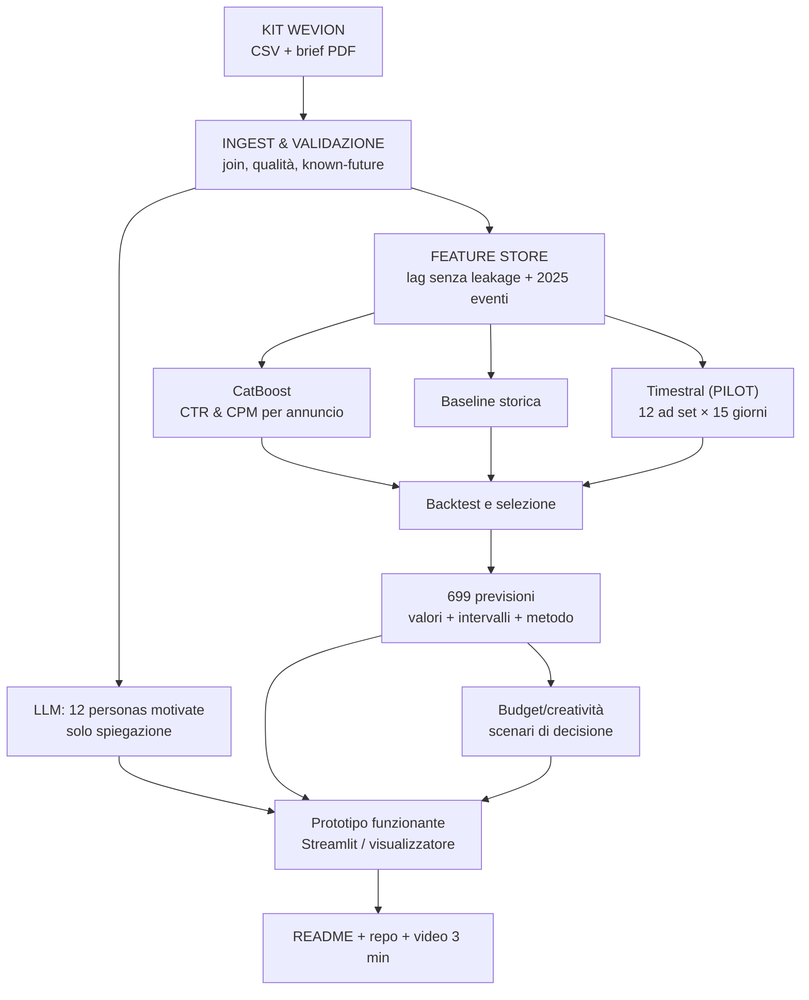

# WEVION · BIG HACK 2026 — SPECIFICA OPERATIVA v4

**Autorità delle fonti:** (1) `Wevion-BigHack-sfida.pdf`, pagine 1–2; (2) `LEGGIMI.md` del kit; (3) CSV del kit, verificati localmente; (4) documentazione ufficiale Timestral; (5) ipotesi/decisioni progettuali. In caso di contrasto, prevale il PDF. **Tutti i dati del kit sono simulati**: non sono dati di clienti reali. Documento aggiornato il 14/11/2026, a seguito della consegna del materiale.

> **Correzione sostanziale rispetto alla v3:** non siamo più in uno scenario con annunci reali di esito ignoto e senza storico. Wevion ha fornito un problema di forecasting supervisionato per **3 campagne Meta, 12 ad set, 69 annunci complessivi, 91 giorni storici, 15 giorni futuri, 699 righe-obiettivo**. È richiesto un **prototipo o codice funzionante**, non soltanto un video; il video deve durare **3 minuti**. Gli scraper pubblicitari esterni e la generazione massiva di personas non sono il cuore della soluzione. Il focus è **accuratezza CTR/CPM per annuncio/giorno, spiegazione dell'audience ipotizzata e decisioni di budget e creatività**.

## 1. Brief ufficiale, obiettivi e consegna

**PDF, pagina 2 — tre compiti:**

1. **Immaginare e motivare il pubblico di ciascun ad set**, sulla base dei numeri; l'identità reale del pubblico è intenzionalmente nascosta. È vietato chiedere agli organizzatori il pubblico reale.
2. **Prevedere CTR e CPM per ogni annuncio, giorno per giorno, 16–30 novembre 2026**, comprese le date del Black Friday e del Cyber Monday.
3. **Supportare una decisione di marketing:** dove e quanto budget allocare, quale creatività scegliere, quale leva utilizzare e in quali giorni.

**Criterio centrale testuale:** la previsione quantitativa e la capacità di motivarla. Altri KPI, come CPC, sono facoltativi, purché derivati coerentemente dai dati.

**Tre deliverable richiesti:**

- **Strumento:** repository con codice oppure prototipo funzionante che mostri pubblici, previsioni e decisioni. Un'app Streamlit che legge output precomputati più una pipeline Python riproducibile soddisfa lo scopo progettuale senza richiedere una SaaS complessa.
- **Previsioni:** valori CTR e CPM per **tutte le 699 righe** di `da_prevedere.csv`; allegare CSV/JSON con chiavi originali e, per la UX, intervalli d'incertezza.
- **Ragionamento:** 12 pubblici ipotizzati (uno per ad set), evidenze e metodologia nel README, **video di esattamente circa 3 minuti**. La versione precedente da 3–4 minuti va ridotta.

**Estensione opzionale, non prioritaria:** generare nuove creatività, farle valutare al pubblico sintetico, stimarne le prestazioni. Si sviluppa soltanto dopo aver completato previsione, validazione e interfaccia.

## 2. Inventario verificato del kit

| File | Dimensione logica verificata | Ruolo |
|---|---:|---|
| `inserzionisti.csv` | 3 righe | 3 vertical: `beauty_skincare`, `pet_ecommerce`, `abbigliamento` |
| `campagne.csv` | 3 righe | Meta, obiettivo `vendite` |
| `adset.csv` | 12 righe | 4 ad set per campagna, pubblico non fornito |
| `annunci.csv` | 69 righe | Collegamenti `ad_id` → `asset_id` → `adset_id`; avvio/fine |
| `asset_creativi/asset_*.csv` | 36 asset, 12 per vertical | `scarcity`, `urgency`, `black_friday`, formato, testi, CTA, **descrizione** del visual (non file immagine) |
| `storico_giornaliero.csv` | **1.879 righe, 91 giorni** | 17/08–15/11/2026; spesa, impressioni, click, CTR, CPM, copertura, frequenza, CPC |
| `budget_giornaliero.csv` | 1.272 righe | Budget pianificato per 12 ad set nei 106 giorni totali |
| `da_prevedere.csv` | **699 righe** | 16–30/11/2026; chiavi, leve, formati e budget, senza outcome |
| `cpm_storici.csv` | **704 righe** | CPM mensili 2025–ottobre 2026, per piattaforma/paese/obiettivo, con quartili e numerosità |
| `benchmark_mercato_settimanale_2025.csv` | **66 righe** | Indici settimanali CTR/CPM per vertical, Meta IT, incluse Black Week 2025 e settimane successive |
| `calendario.csv` | 106 righe | Weekend, 20/11 Black Week, **27/11 Black Friday**, **30/11 Cyber Monday** |

**Relazioni:** `campagne` → `adset` → `annunci` → `asset_creativi`. L'asset può essere riutilizzato in più ad set; evitare duplicazioni nell'aggregazione. Un campione non copre tutte le combinazioni annuncio/giorno: gli annunci hanno date di attività diverse; non generare righe non presenti in `da_prevedere.csv`.

### 2.1 Struttura e difficoltà effettive del forecasting

- **57 annunci** appaiono nello storico, **51 annunci** nel periodo futuro; il kit complessivo ne contiene 69.
- **12 annunci sono completamente nuovi in previsione** (4 per settore); producono **114 delle 699 righe future**. Senza storico dell'annuncio, la previsione va inferita da ad set, asset/leve/formato e altre creatività correlate.
- **6 asset nuovi** sono presenti solo nel futuro: `CDF-B3`, `CDF-B4`, `FGR-B3`, `FGR-B4`, `NDL-B3`, `NDL-B4`. Sono creatività Black Friday. Alcuni annunci nuovi dello stesso settore e asset condividono contenuto ma hanno ad set differenti.
- Il numero di righe giornaliere cresce da **39 (16–19/11)** a **45 (20–22/11)** e **51 (23–30/11)**. Predire con un insieme statico di soli annunci storici perderebbe 114 righe.
- **CTR/CPM non vanno interpretati come valori direttamente indipendenti:** `CTR = 100 × click/impression`; `CPM = 1000 × spesa/impression`. Non usare contemporaneamente outcome futuri non disponibili come feature predittive.
- Il budget è condiviso al livello **ad set**. Non attribuire l'intero budget a ogni annuncio, altrimenti la spesa è contata più volte. La somma dei budget pianificati è **1.130 €/giorno**, **16.950 €** per i 15 giorni; sono valori di budget, non spesa necessariamente realizzata.
- **Verifica qualità:** su **21/10/2026, FGR-AS1**, la spesa aggregata del giorno è **397,55 €** contro un budget di **100 €** (quasi 4×). Flaggarla, indagarne l'effetto sui modelli di spesa e non alterare tacitamente il CSV. Sono presenti anche giorni/annunci con click = 0 e CPC mancante, che vanno gestiti senza divisioni per zero.

### 2.2 Dati futuri noti vs dati vietati

**Noti prima della previsione**: date/weekday/eventi, `adset_id`, `ad_id`, `asset_id`, formato, leva, testo/visual descrittivo, data lancio, budget futuro pianificato, benchmark **2025** e CPM storici **fino a ottobre 2026**. Possono entrare nelle feature per il 16–30/11.

**Non noti**: CTR, CPM, click, impressioni, spesa, frequenza, copertura effettivi dal 16/11. Non utilizzare le label `periodo = validazione/test` come feature del modello. La serie 2025 è un indice stagionale, **non un outcome di queste campagne**.

**Regola sulle fonti:** il PDF dice espressamente che i numeri sono simulati e «non cercate risultati veri fuori dal kit: non esistono». **Non cercare le campagne sintetiche su Meta/TikTok/Google Ads.** Il kit contiene già dati di mercato simulati molto più pertinenti. Fonti pubbliche possono essere citate come metodologia generale, ma non sostituite ai valori del kit o presentate come etichette verificate delle tre campagne.

## 3. Problema matematico e schema dei risultati

Previsione indipendente dalle etichette future per ogni coppia `(ad_id, data)` presente in `da_prevedere.csv`:

\[
\widehat{CTR}_{a,t}=P(click\mid impression,a,t)\times100,\qquad
\widehat{CPM}_{a,t}=\frac{\widehat{spesa}_{a,t}}{\widehat{impression}_{a,t}}\times1000.
\]

L'output minimo deve contenere `data, ad_id, adset_id, asset_id, ctr_predetto_pct, cpm_predetto_eur`. Aggiungere `ctr_p10, ctr_p90, cpm_p10, cpm_p90` dopo la calibrazione degli intervalli, non come valori inventati; `model_version, scenario`, opzionali. Conservare anche `vertical`, `leva`, `formato` per la dashboard.

`CPC_predetto = CPM_predetto / (10 × CTR_predetto_pct)` se `CTR_predetto_pct > 0`, **solo come quantità derivata**. Per prevedere impression/click a budget dato è necessario stimare la quota di spesa assegnata a ciascun annuncio all'interno dell'ad set.

**Metriche di validazione:** MAE del CTR in **punti percentuali** (non in percento relativo); MAE CPM in **€/1000 impressioni**; WMAE ponderato per impression; ranking corretto delle creatività a parità di ad set/periodo; copertura e ampiezza degli intervalli. Non dichiarare KPI aggiuntivi come accuratezza reale se non misurati.

## 4. Strategia di modellazione raccomandata

### 4.1 Baseline molto semplice — obbligatoria

Calcolare CTR e CPM pesati su conteggi effettivi usando gli ultimi 7/14 giorni storici disponibili, gerarchia di fallback: `ad_id` → `asset_id` → `adset_id` → `vertical` → globale. Per CTR aggregato usare **somma(click) / somma(impression)**, per CPM **somma(spesa) / somma(impression)**, mai semplice media dei rapporti se si stanno aggregando volumi diversi. Appena possibile, aggiungere weekday e componente di trend stagionale; il tutto dev'essere riproducibile e senza leak.

### 4.2 Modello supervisionato per creatività e cold start — CatBoost / LightGBM

CatBoost (o LightGBM) lavora sulle **1.879 righe** e apprende differenze fra inserzionisti, ad set, annunci e asset anche per serie corte. Feature:

- **Identità/gerarchia:** `vertical`, `campaign_id`, `adset_id`, `ad_id`, `asset_id` con fallback per categorie nuove.
- **Creatività:** `leva`, `formato`, durata video, lunghezza headline/testo/CTA, segnali qualitativi estratti da `descrizione_visual` e testo, data di lancio, età dell'annuncio.
- **Temporali:** giorno della settimana, weekend, trend, periodo dall'avvio, `days_to_black_friday`, settimane Black Week, Cyber Monday; budget di ad set noto fino al 30/11.
- **Storiche:** CTR/CPM aggregati e rolling window di ad, asset, ad set e vertical, calcolati **solo su giorni precedenti alla riga** in training, congelati all'origine del forecasting in validazione e test.
- **Mercato:** indici CTR/CPM settimanali del 2025 allineati rispetto alla **settimana del Black Friday**, CPM storico ottobre 2026 e differenze stagionali 2025, senza doppio conteggio dei salti.

Target consigliati: logit del CTR frazionario (gestendo 0 click tramite smoothing) e `log(CPM)`. Decodifica con sigmoid e exp per garantire CTR 0–100 e CPM positivo. In alternativa modellazione binomiale click su impression (GLM/GBDT) per gestire la diversa varianza di CTR a diversi volumi. Limitare complessità: solo 36 asset unici, quindi embeddings ad alta dimensione e fine-tuning visivo sono probabili fonti di overfitting; 5–15 feature testuali controllate sono preferibili.

**Cold start:** le 12 nuove identità ad non vanno previste con una serie tutta zero. Il modello basato sui metadati condivide forza statistica tra annunci, ad set e creatività; dove `asset_id` è inedito, usare descrizione/format/leva e prior di settore. Incertezza più ampia per questi 114 casi.

### 4.3 Timestral — parte temporale dell'ibrido, non scorciatoia

**Verifica ufficiale:** Timestral è una famiglia TSFM di Mistral (annuncio 15 ottobre 2026), con modelli **5M, 28M, 123M, 209M**, fino a **32.768 passi** di contesto, **21 quantili** in output, **covariate passate e note nel futuro**, inferenza CPU/GPU. [Blog Mistral](https://mistral.ai/news/timestral/) · [repo ufficiale](https://github.com/mistralai/timestral/).

**Scelta pratica per questo kit:** non avviare un Timestral separato su ogni `ad_id` come unico modello (poche osservazioni per annuncio, 12 serie interamente assenti). Usarlo inizialmente su **12 serie giornaliere di ad set** con almeno 91 osservazioni storiche, dove possibile: **CTR e CPM aggregati a livello ad set**, calcolati da click, impression e spesa. L'aggregato giornaliero non richiede che tutti gli annunci siano costantemente attivi.

Formato di inferenza ufficiale: `context` con shape `(B, V, T)`, per esempio **(12, 2, 91)**; `prediction_length=15`; `known_covariates` con shape `(B, C, 106)` per dati noti su passato e futuro. Inserire budget ad set, indici 2025 riallineati, eventi e weekday; eventuali quantità di creative attive suddivise per leva e formato. Timestral restituisce mediana e quantili, non percentuali di clic calibrate per definizione. Quantili CTR/CPM possono richiedere trasformazioni e calibrazione empirica. Se una serie resta invariante, evitare di passare categorie non informative.

**Limite cruciale:** l'informazione sul picco del **Black Friday 2026** è assente dal target storico; un modello temporale zero-shot non può ricostruirla con certezza soltanto da 91 punti osservati. Gli **indici settimanali 2025** e il calendario sono covariate/priors essenziali. Evitare di moltiplicare un CPM di novembre 2025 già stagionale per un indice Black Friday, che conterebbe il picco due volte. Usare confronti con baseline autunnale e validare la taratura sul 2026 precedente.

**CPU / dimensioni ufficiali**: 5M ≈ 21MB, 28M ≈ 111MB, 123M ≈ 490MB, 209M ≈ 837MB di pesi fp32. **Partire da 28M**; provare 123M/209M solo se migliori nel backtest. Nessun motivo di caricare un modello enorme senza dimostrare un vantaggio; il tempo va speso sul dataset. Il codice Timestral è Apache 2.0, i pesi hanno **Modified MIT** propria: mantenere notice e verificare le condizioni. Install ufficiale: `pip install git+https://github.com/mistralai/timestral.git`.

Snippet API **verificato sul README, ma non eseguito qui**:

```python
import numpy as np
from timestral import TimestralForecaster

model = TimestralForecaster.from_pretrained("mistralai/Timestral-28M")
# context: (12, 2, 91) -> target CTR e CPM aggregati degli ad set
# future_covariates: (12, C, 106) -> budget, mercato 2025, eventi, calendario
forecast = model.forecast(
    context=np.asarray(context, dtype=np.float32),
    prediction_length=15,
    known_covariates=np.asarray(future_covariates, dtype=np.float32),
)
p50 = forecast.median  # (12, 2, 15)
p10 = forecast.quantile(0.1)
p90 = forecast.quantile(0.9)
```

**Ibridazione condizionale:** Timestral stima regime/andamento temporale di CTR e CPM per ad set; CatBoost stima livelli e differenze per annuncio e creatività. Un adattatore combina le previsioni sotto vincoli e con un coefficiente deciso **solo mediante backtest**. Esempio: moltiplicare il CTR previsto da CatBoost per il rapporto fra previsione Timestral di ad set e baseline di ad set, con limitazione del fattore e correzione dei limiti del CTR. La combinazione **non è obbligatoria**: se peggiora il backtest, preferire CatBoost con covariate stagionali o baseline.

### 4.4 È sensato usare il modello Decision 1 o molte personas per il CTR?

Solo come **layer esplicativo e input creativo**, non come sorgente primaria del CTR numerico. Ora gli outcome storici esistono: sono più informativi dei click «ipotetici» di LLM, e la challenge premia la precisione. Le personas possono motivare il pubblico non fornito per ciascun ad set e le possibili leve di creatività. Eventuali punteggi persona non diventano direttamente percentuali CTR senza calibrazione.

### 4.5 Altre alternative per il forecasting

**Prima del TSFM**: regressione con CatBoost/LightGBM, regressione gerarchica e baseline. **Altri TSFM**: [Chronos-2](https://github.com/amazon-science/chronos-forecasting) e [TimesFM](https://github.com/google-research/timesfm), entrambi con strumenti per covariate, ma aggiungerli solo dopo una baseline solida. Con 91 giorni e 12 serie stabili, la validazione cronologica sul dominio ha più valore dei benchmark generali pubblicati. Non fare fine-tuning Timestral durante l'hackathon salvo chiaro beneficio e risorse effettivamente disponibili.

## 5. Informazione Black Friday: valorizzare i dati 2025 forniti

`benchmark_mercato_settimanale_2025.csv` è **la fonte migliore per anticipare uno shock stagionale non visto nello storico agosto–15 novembre 2026**. Per ogni `vertical`, usare indici CTR/CPM settimanali in 2025, allineando le **settimane della Black Friday**: la settimana che comincia il **24/11/2025** corrisponde a quella del **23/11/2026** (stesso posizionamento di evento; le date variano di 364 giorni). `2025-11-17` → `2026-11-16`, ecc.

Esempi verificati dalla **settimana del 24/11/2025**:

| Vertical | Indice CPM | Indice CTR |
|---|---:|---:|
| Beauty/skincare | 156,6 | 123,7 |
| Pet/e-commerce | 156,2 | 115,8 |
| Abbigliamento | 159,9 | 135,1 |

Indice `100` equivale alla media settembre–ottobre 2025; quindi l'indice **non è un CTR in percentuale né un CPM in euro**. Questi rapporti costituiscono un *prior di scenario*, non un risultato nascosto delle campagne 2026. Per trasformarli in previsioni assolute, stimare la relazione tra livello storico della campagna, trend 2026 e corrispondente indice 2025 usando solo dati prima del cutoff. Produrre almeno scenario conservativo/centrale/alto del possibile shock; quantificare l'incertezza maggiore per il 27/11 e gli asset nuovi.

`cpm_storici.csv` aggiunge un riferimento distinto: quantili mensili per piattaforma, paese e obiettivo (nell'ottobre 2026, `meta/IT/vendite`: **mediana 7,55 €, Q1 5,35 €, Q3 11,17 €**). **Non esiste novembre 2026 nel file**. L'Italia è suggerita dal benchmark settimanale Meta IT e dal contesto delle campagne, ma lo `storico_giornaliero` non contiene una colonna `paese`: usare Meta IT come riferimento dichiarando esplicitamente l'assunzione.

## 6. Esperimento quantitativo già eseguito in questa revisione

È disponibile `Wevion_Validation_Baseline.py` con due **holdout temporali**, tutti i lag calcolati da soli dati antecedenti e congelati all'origine della finestra; CatBoost su CTR (logit) e CPM (log). È **un primo esperimento locale**, non una classifica fra tutti i metodi e **non include Timestral**.

| Origin / validazione | Osservazioni | MAE CTR baseline | MAE CTR CatBoost | MAE CPM baseline | MAE CPM CatBoost |
|---|---:|---:|---:|---:|---:|
| 19/10–01/11 (storico fino al 18/10) | 315 | **0,2451 pp** | 0,3536 pp | 0,7986 € | **0,7122 €** |
| 02/11–15/11 (storico fino al 01/11) | 444 | 0,3163 pp | **0,2743 pp** | 1,0218 € | **0,9274 €** |

**Interpretazione:** CatBoost non domina sempre sulla baseline; nel primo fold il CTR peggiora, nel secondo migliora. Il primo test non contiene il regime Black Friday vero, quindi non può misurare direttamente l'accuratezza nel periodo 27–30 novembre. La complessità va scelta per la sua utilità nel backtest, non per prestigio.

**Prossimo esperimento minimo:** confrontare `baseline`, `CatBoost`, `Timestral-28M` ad set-level e `ibrido` su entrambi i fold. Per tuning del modello usare principalmente il fold precedente e trattare 02/11–15/11 come verifica finale di sviluppo; non ottimizzare ripetutamente tutti i parametri fino a sovradattarsi ai 14 giorni finali. Verificare anche il sottogruppo **annunci senza storia** e la qualità/ampiezza di intervalli q10–q90.

## 7. Inferire il pubblico: 12 schede, con cautela statistica

L'audience dei 12 ad set **non è osservata**: non è scientificamente possibile risalire a età/genere reali dai soli click e CPM senza ulteriore informazione. È invece possibile produrre **12 ipotesi motivate** sui comportamenti più compatibili con gli indizi.

Per ogni ad set generare una scheda sintetica:

```
adset_id
segmento_ipotizzato: descrizione comportamentale, non demografia certa
segnali_osservati: CTR storico, CPM, formato preferito, sensibilità a leva,
                  response a budget, frequenza, trend recente
ipotesi: tipo di pubblico che potrebbe produrre quei segnali
alternative: almeno una interpretazione diversa degli stessi dati
confidence: bassa/media/alta come fiducia qualitativa, NON dato misurato
strategie: creatività/leva e giorni da provare
```

Metodologia: confronti con ad set **all'interno della stessa campagna**, CTR pesato per impressioni, trend recente, performance di formati/leve e sostegno di headline/visual. Senza dati sperimentali non affermare causalmente che un messaggio 'ha causato' la risposta. Se si usa LLM, fornire a ciascun agente una **scheda numerica ad set e un campione di creatività**, richiedendo motivazioni ancorate ai dati e alternative; niente allucinazioni su audience osservate. Una scheda per ad set basta per l'MVP; simulare centinaia di persone non è giustificato.

## 8. Motore di decisione: budget e creatività

**Budget di riferimento pianificato: 1.130 € complessivi al giorno.** Stimare per ogni ad set il rapporto di resa:

\[
\text{click attesi/€}\approx \frac{10\times CTR_{\text{pct}}}{CPM_{€}},
\quad \text{click attesi}\approx B_{\text{effettivo}}\times\frac{10\times CTR_{\text{pct}}}{CPM_{€}}.
\]

Questo rapporto assume che budget speso generi impressioni al CPM previsto. Nel kit lo spending effettivo degli ad set è quasi sempre inferiore al budget: stimare il **pacing** storico invece di equiparare budget a spesa. Inoltre gli annunci condividono lo stesso budget: per calcolare click per creatività serve stimare la **quota di delivery** dell'ad set (dalla storia con fallback), non assegnare B a tutti gli ads.

**Output delle decisioni:** per ogni vertical/campagna data, mostrare `adset consigliato`, `creatività/lever consigliata`, `eCTR`, `eCPM`, `click stimati per budget`, incertezza e «perché». Simulare riallocazioni *a budget totale invariato*, per esempio entro ±20% per ad set; applicare bounds di spesa, minimi e massimi, preservare la possibilità di esplorazione per creatività nuove. **Importante:** la storia non dimostra causalmente che aumentando il budget CTR/CPM rimangano invariati. Etichettare come **scenario what-if condizionale**, non ritorno garantito.

Per il decisore in 10 secondi, dashboard iniziale: **chi colpire, miglior annuncio, variazione prevista durante Black Week, dove spostare € e livello di incertezza**. Drill-down giornaliero e spiegazione per dettaglio.

## 9. Architettura eseguibile: T3 Code come coordinamento di sviluppo, Python per inferenza



**T3 Code:** mantenere come orchestratore **del lavoro di sviluppo**, con task/subagenti distinti: `data-audit`, `feature-engineering`, `forecast-baseline`, `timestral-eval`, `audience-inference`, `decision-optimizer`, `viewer-motion-design`. La pipeline di inferenza del prototipo resta Python, deterministica e riproducibile; non deve dipendere dalla riapertura della chat o dal singolo account di un coding agent. Rispettare le quote di Codex e Gemini ma non spendere token delle LLM per calcolare 699 rapporti statistici.

**Struttura repository consigliata**:

```text
wevion-predict/
  README.md                     # tecnica, risultati backtest, pubblico ipotizzato
  pyproject.toml                # o requirements.txt con versioni
  data/                         # kit originale solo se permesso dal regolamento
  src/
    ingest.py                   # join, schema, QA
    features.py                 # past-only e known-future
    baselines.py                # fallback ad->asset->adset->vertical
    train_catboost.py           # due target, validazione temporale
    run_timestral.py            # esperimento opzionale a livello adset
    backtest.py                 # holdout, metriche, cold-start
    forecast.py                 # 699 righe, controllo integrità
    personas.py                 # 12 schede con evidenza
    decisions.py                # raccomandazioni e scenari
  app.py                        # visualizzatore funzionante
  outputs/
    forecasts_2026-11-16_30.csv
    persona_adset.json
    decisions.csv
    validation_metrics.json
  video/
    pitch_3min.mp4
```

**Controlli invarianti prima della consegna:** `len(output)==699`; unicità `(data, ad_id)`; chiavi e date identiche a `da_prevedere.csv`; nessun nullo CTR/CPM; CTR compreso fra 0 e 100%; CPM maggiore di 0; nessuna colonna target del periodo futuro usata in train; versioni di script/modello salvate; numeri della demo corrispondenti ai CSV (mai illustrativi spacciati per predetti).

## 10. Piano di esecuzione prioritario

**P0 — MVP quantitativo (subito):** QA e join del kit; baseline con fold di validazione; CatBoost e confronto; produrre `699 righe` con CTR/CPM anche usando soltanto il miglior modello validato. L'indice 2025 deve diventare feature ed eventualmente scenario stagionale; non proiettare direttamente il trend di agosto su BF.

**P1 — Timestral pilot:** aggregare 12 ad set a giorno; costruire future covariates **106 giorni**; avviare 28M; backtest vs baseline e CatBoost; adottarlo solo se riduce l'errore o migliora le bande. Se manca l'installazione/tempo, il modello finale resta CatBoost, non il contrario.

**P2 — Pubblico e decisione:** 12 schede comportamento/evidenze; motore scelta creatività e riallocazione con budget fisso e incertezza.

**P3 — Consegna:** viewer esplorabile (12 ad set, 15 date, 3 vertical), repository riproducibile, README e pitch **3 minuti**; test da nuovo clone in ambiente pulito.

**P4 — solo se avanza tempo:** generazione e valutazione di nuove creatività, test alternativi TSFM/Decision 1, animazioni extra. Non sacrificare P0–P3.

### Criteri di stop

- Se un esperimento Timestral richiede più tempo della baseline e del viewer messi insieme, disattivarlo; mantenere la proposta metodologica e i risultati quantitativi ottenuti.
- Se una nuova feature peggiora due finestre cronologiche, rimuoverla.
- Se il layer personas non fornisce motivazioni verificabili su `adset_id`, ridurre dettagli narrativi e rafforzare tabelle di evidenza.
- Non chiamare scraper commerciali per recuperare KPI di inserzionisti fittizi.

## 11. Video, motion design e interfaccia rivisti per la nuova challenge

Mantenere le **ultime due direzioni grafiche bianche**, vettoriali e asciutte; testo nero, un accento viola secondario, loghi verificati (T3 Code, Mistral, Python e framework effettivamente usati). Non mostrare come operativi modelli non eseguiti. **Sostituire le vecchie 10 slide basate principalmente su 1000 personas con 10 scene sul modello quantitativo e le 699 previsioni**.

| Durata | Scena | Animazione suggerita |
|---|---|---|
| 0–15 s | Sfida: decidere prima di spendere | Grafica Meta → CTR/CPM in nero → punto interrogativo |
| 15–29 s | Kit Wevion: 91 giorni, 12 ad set, 15 futuri | Timeline che corre da agosto a novembre; 15 giorni futuri in viola |
| 29–45 s | Pubblico nascosto | 12 ad set → schede persona con 2 numeri osservati ciascuna |
| 45–66 s | Forecast engine | Due blocchi CatBoost/Timestral con flussi distinti; Timestral solo se provato |
| 66–82 s | Shock Black Friday | Indici 2025 si sovrappongono alla linea 2026 e marcano il 27/11 |
| 82–107 s | Validazione reale | Backtest 02–15/11; curve previste vs osservate; mostrare MAE misurato |
| 107–137 s | 699 valori | Heatmap ad × data, CTR/CPM e intervalli, zoom su ad nuovo |
| 137–165 s | Decisioni | Budget spostato con slider, KPI previsti e cautela del modello |
| 165–180 s | Chiusura | Logo progetto, valore per Wevion, risultati consegnati |

A differenza della v3, il **video da 3 minuti è espressamente parte della consegna del kit**, non una scelta dedotta da edizioni precedenti. L'app deve essere un vero prototipo funzionante, anche se calcola in batch e legge previsioni già salvate. Motion design utile se rafforza accuratezza, intervalli, leggibilità della decisione; non sostituisce modello o repo.

## 12. Quattro domande ancora sensate per gli specialist Wevion

1. «Per la precisione valuterete MAE sui 699 CTR/CPM, ranking, confronto per vertical o una combinazione? Ci sono criteri di scoring pubblicati?»
2. «La previsione deve essere consegnata in un formato CSV/JSON preciso o basta che sia esportabile dal prototipo?»
3. «Per l'ottimizzazione del budget possiamo considerare trasferimenti fra ad set della stessa campagna, mantenendo il totale giornaliero, oppure è prevista libertà anche tra campagne?»
4. «La metrica primaria è `CTR` da click/impression e `CPM` da spesa/impression come nel README? Gli intervalli di confidenza e la validazione 02–15/11 verranno valorizzati?»

**Non chiedere** il pubblico reale dei 12 ad set: il PDF lo esclude esplicitamente.

## 13. Fonti tecniche e log di verifica

- `Wevion-BigHack-sfida.pdf`, p.1 e p.2, archivio fornito dagli organizzatori il 14/11/2026.
- `LEGGIMI.md`, stesso archivio, struttura dati, formule e proposta di holdout 02/11–15/11.
- CSV del kit ispezionati programmaticamente e confrontati sulle chiavi/date.
- Mistral AI, [Introducing Timestral](https://mistral.ai/news/timestral/), 15 ottobre 2026.
- Mistral AI, [mistralai/timestral](https://github.com/mistralai/timestral), README e API `TimestralForecaster`.
- Script locale di baseline/backtest: `Wevion_Validation_Baseline.py`; risultati: `Wevion_validazione_baseline.json`. Esegue CatBoost e baseline con cutoff espliciti; **non esegue Timestral**. I due backtest sono un primo esperimento, non un confronto dei TSFM.

**Revisioni v3 → v4:** sostituire l'assunzione «pubblicità reali, risultati sconosciuti» con «kit sintetico etichettato»; sostituire la ricerca scraper con benchmark interni del 2025; estendere il prototipo a **699 predizioni quotidiane**; portare Timestral dal ramo opzionale poco contestualizzato a un test TSFM **a livello ad set**, mantenendo CatBoost per le nuove creatività; ridurre il video a 3 min; aggiungere pubblico ipotizzato per **12** ad set e motore budget; rimuovere dalla priorità il panel massivo di personas e la ricerca di CTR pubblici non disponibili.
