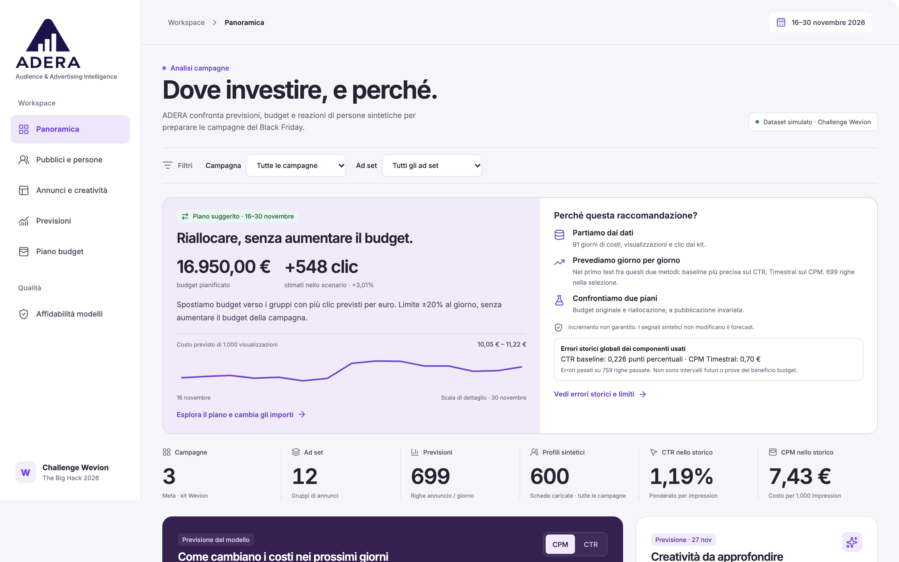
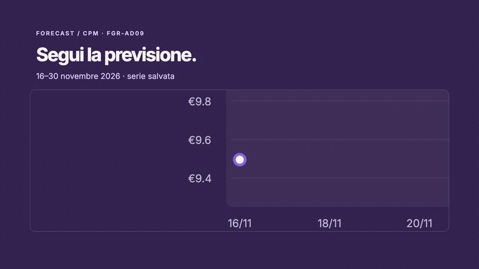
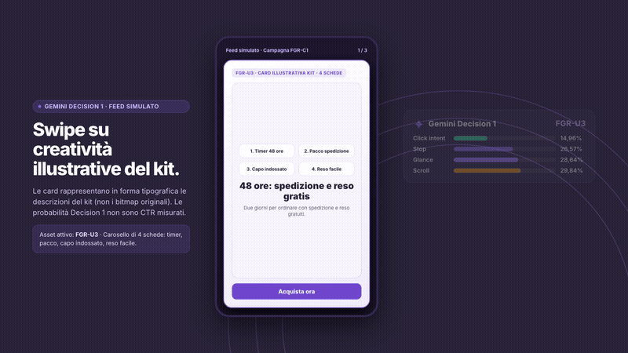
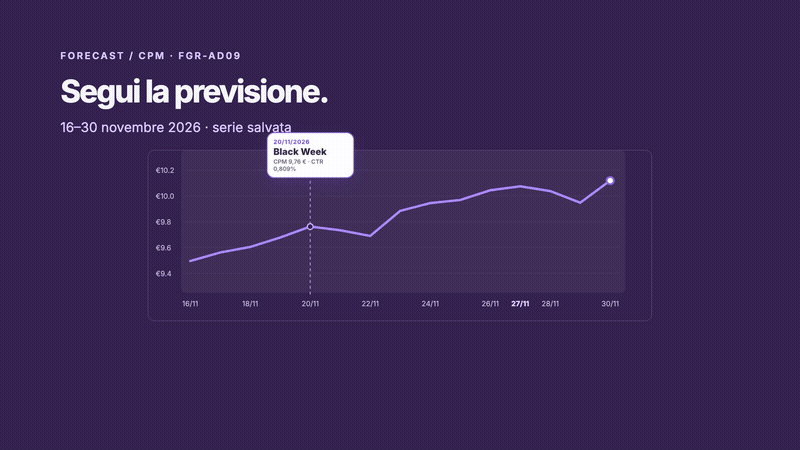
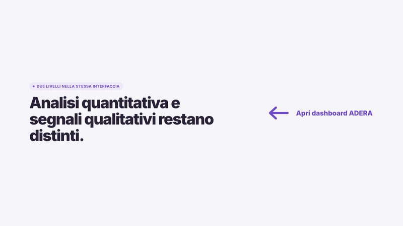
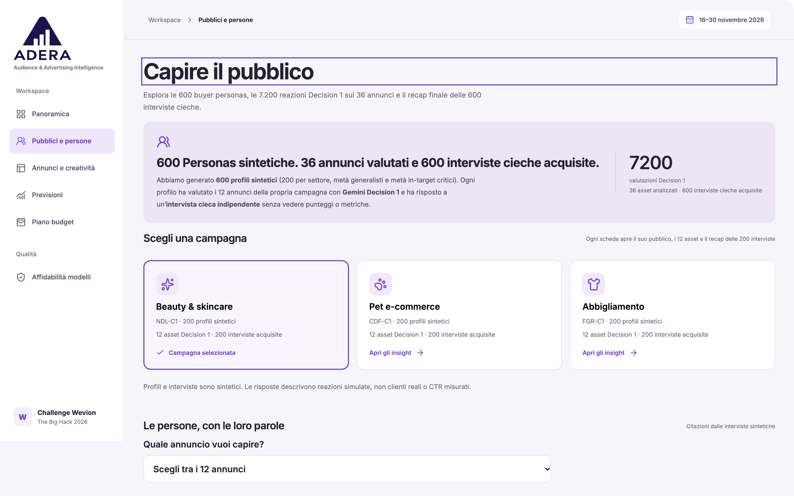
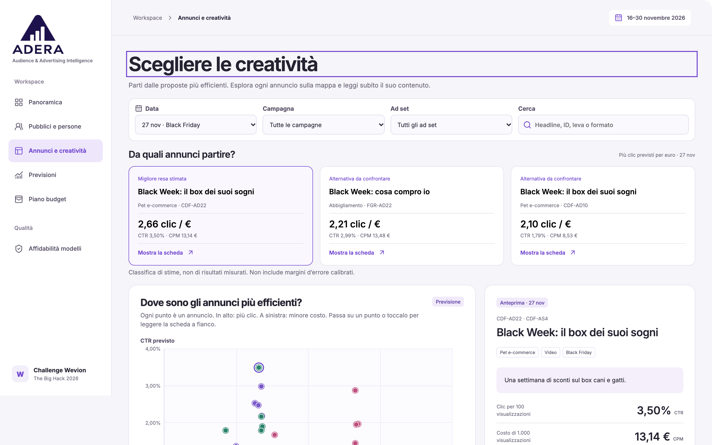
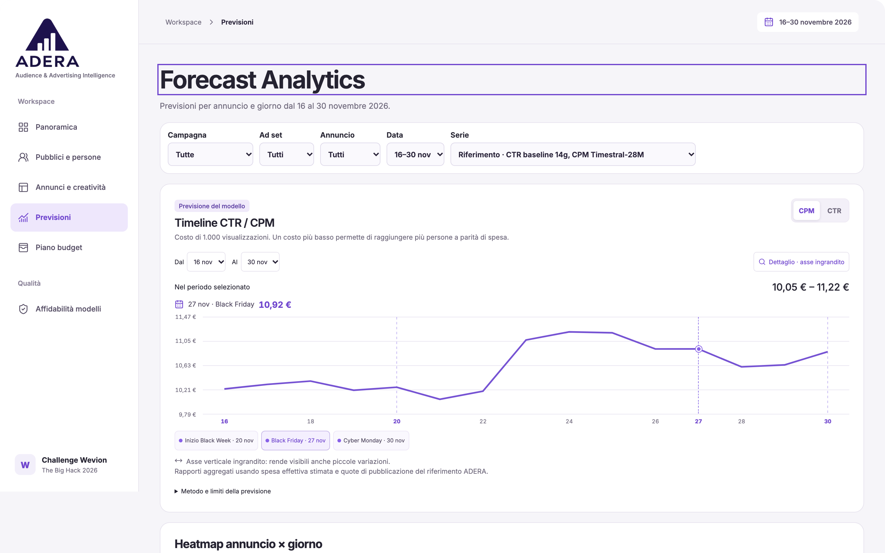
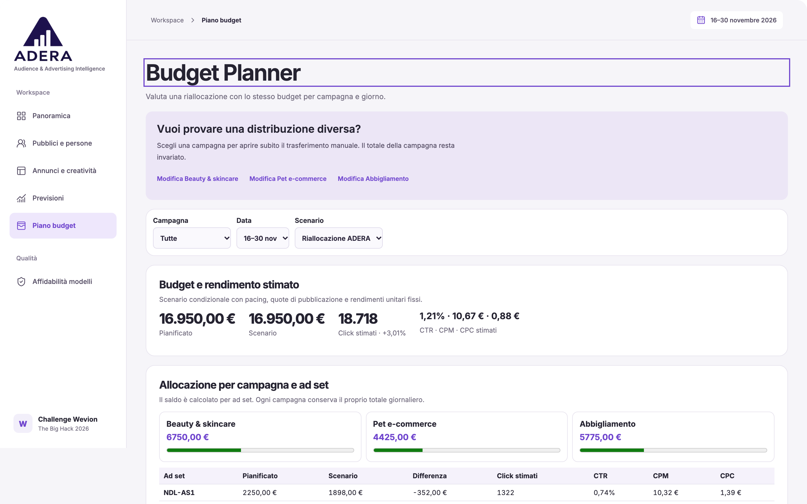
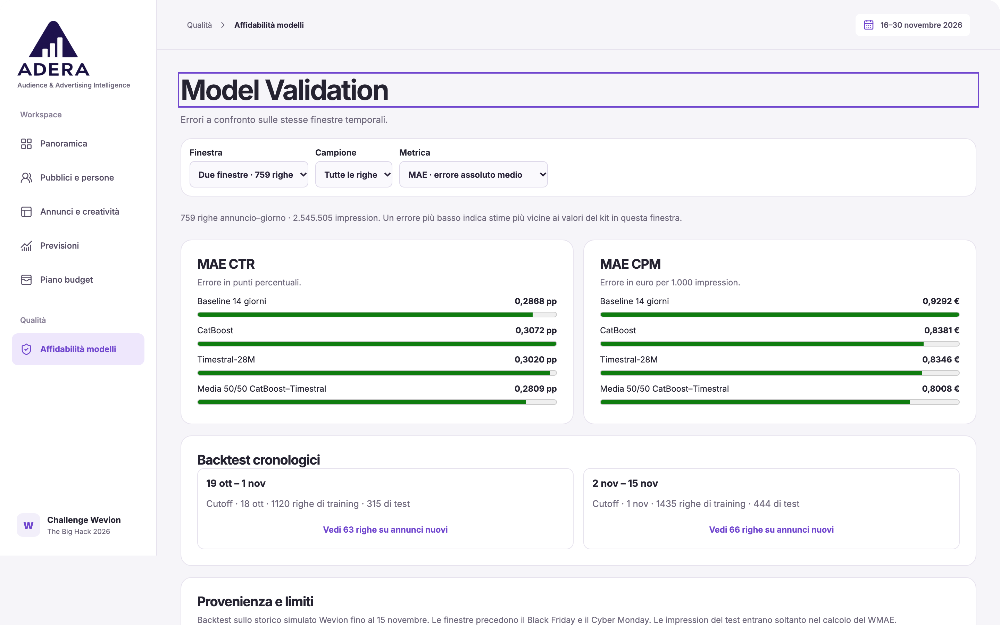

# ADERA — Audience & Advertising Intelligence (Wevion · Big Hack 2026)

> **Decidere prima di spendere:** forecasting quantitativo giornaliero su Meta Ads (`699` coppie annuncio/giorno, `16–30 novembre 2026`), inferenza comportamentale dei `12` pubblici nascosti, riallocazione vincolata di budget (`±20%`) e simulazione diagnostica *outcome-blind* (`600` buyer personas, `7.200` valutazioni **Gemini Decision 1** e `600` interviste cieche), orchestrati da **T3 Code** con una **dashboard puramente esplicativa**.

<p align="center">
  
</p>

> **Dashboard standalone (sola lettura):** apri direttamente [`dashboard/preview.html#/overview`](dashboard/preview.html) nel browser senza server né chiamate API.  
> **Video pitch unificato (150s con voce):** [`video/ADERA-UNIFICATO-150s-CON-VOCE.mp4`](video/ADERA-UNIFICATO-150s-CON-VOCE.mp4)

---

## Indice

1. [Come abbiamo affrontato il problema](#1-come-abbiamo-affrontato-il-problema)
2. [Architettura accoppiata a un Coding Agent (T3 Code)](#2-architettura-accoppiata-a-un-coding-agent-t3-code)
3. [Dashboard esplicativa vs soluzione attiva](#3-dashboard-esplicativa-vs-soluzione-attiva)
4. [Analisi quantitativa: modelli, backtest e Black Friday](#4-analisi-quantitativa-modelli-backtest-e-black-friday)
5. [Validazione con dati esterni senza contaminare l'inferenza](#5-validazione-con-dati-esterni-senza-contaminare-linferenza)
6. [Simulazione sintetica: 600 Personas, Decision 1 e Interviste Cieche](#6-simulazione-sintetica-600-personas-decision-1-e-interviste-cieche)
7. [Estendibilità modulare: integrazione di news e nuovi passaggi di validazione](#7-estendibilità-modulare-integrazione-di-news-e-nuovi-passaggi-di-validazione)
8. [Limitazioni note e discussioni progettuali](#8-limitazioni-note-e-discussioni-progettuali)
9. [Animazioni dal video e tour della dashboard](#9-animazioni-dal-video-e-tour-della-dashboard)
10. [Struttura del repository e riproducibilità](#10-struttura-del-repository-e-riproducibilità)

---

## 1. Come abbiamo affrontato il problema

La sfida richiede tre compiti su **3 campagne Meta** (`NDL` *Beauty & Skincare*, `CDF` *Pet E-commerce*, `FGR` *Abbigliamento*), **12 ad set** con identità di pubblico intenzionalmente nascosta, **69 annunci**, **36 asset creativi** descritti testualmente, **91 giorni storici** (`17 agosto – 15 novembre 2026`, `1.879` righe) e **15 giorni futuri da prevedere** (`16–30 novembre 2026`, `699` righe che includono *Black Week*, *Black Friday* `27/11` e *Cyber Monday* `30/11`):

1. **Ricostruire e motivare i 12 pubblici nascosti** a partire dai numeri, senza inventare attributi demografici non osservabili.
2. **Prevedere `CTR` e `CPM` per tutte le 699 righe `(data, ad_id)`**, gestendo **12 annunci cold-start** (`114` righe senza storico, inclusi `6` asset Black Friday completamente inediti) e uno shock stagionale che nello storico recente vale sempre `0`.
3. **Supportare decisioni operative** su riallocazione del budget e scelta delle creatività.

Fin dall'inizio abbiamo scelto un principio architetturale rigido: **separazione netta tra binario quantitativo (Track A) e simulazione qualitativa (Track B)** attraverso un *Information Boundary* verificabile:

- **Track A (Quantitativo)** calcola `CTR = 100 × click / impression` e `CPM = 1000 × spesa / impression` dai conteggi aggregati, confronta più famiglie di modelli su **due finestre cronologiche anti-leakage**, deduce i **12 profili comportamentali** confrontando ad set fratelli *a parità di asset e giorno*, e calcola scenari di riallocazione budget `±20%` a totale campagna giornaliero invariato (`€16.950` complessivi sui 15 giorni).
- **Track B (Simulazione Sintetica *outcome-blind*)** genera **600 buyer personas** (`200` per settore, `50% unbiased` e `50% category_conditioned` critiche) senza esporre mai storico, CTR/CPM, audience inferite o forecast; sottopone ogni singola persona a un feed controllato tramite **Gemini Decision 1** (`7.200` valutazioni) e conduce **600 interviste cieche** per spiegare *perché* una creatività attira attenzione o genera scetticismo.
- I segnali sintetici hanno **`calibrated_to_ctr: false`**: non vengono mai trasformati arbitrariamente in CTR numerico né usati per alterare le previsioni del Track A, ma affiancano le decisioni quantitative per spiegare le obiezioni e prioritizzare gli annunci cold-start.

---

## 2. Architettura accoppiata a un Coding Agent (T3 Code)

ADERA non è progettato come un'applicazione monolitica chiusa, ma come **sistema modulare pensato per essere accoppiato a qualsiasi coding agent**. Nel progetto abbiamo utilizzato **T3 Code** come orchestratore centrale perché ha permesso di coordinare **più modelli eterogenei in parallelo**, mantenendo separati ruoli, contesti e contratti verificabili:

| Ruolo nella pipeline | Modello / Runtime utilizzato | Modalità di orchestrazione via T3 Code | Output verificato |
|---|---|---|---|
| **Forecasting temporale ad set** | **Mistral Timestral-5M & 28M** (CPU, zero-shot) | Esecuzione locale offline (`HF_HUB_OFFLINE=1`) + verifica riproducibilità | Serie `12 × 2 × 91` + `7` covariate note (`106` gg) |
| **Forecasting tabulare ad-level** | **CatBoost Regressor** (`logit CTR`, `log CPM`) | Backtest e tuning controllato su 27 feature con lag `l7` strict-past | Confronto diretto su Fold 1, Fold 2 e cold-start |
| **Baseline & Delivery** | **Python 3.12** (`weighted_hierarchical_14d_v1`) | Pipeline deterministica + suite automatica di test anti-leakage | `699` previsioni, `12` audience, `180` righe budget |
| **Generazione 600 Personas & Interviste** | **Gemini 4 Hydrogen** + **Sol (Codex)** | Subagenti T3 paralleli isolati per batch (`24` job da `25` personas; batch interviste multi-settore) | `600` schede uniche (`534` professioni) + `600` interviste cieche |
| **Valutazioni feed isolate** | **Gemini Decision 1** (`v1beta` `decisions.create`) | Worker dedicato con chunking (`25` domande), pacing `45.000 TPM` e cache SQLite | `7.200` valutazioni (`36` asset × `200` personas/settore), `228` richieste |
| **Dashboard & Video Pitch** | **React/Vite** + **HyperFrames / Playwright / FFmpeg** | Skill dedicate in [`skills/`](skills/) per UI, export statico, montaggio unificato e voce | [`dashboard/preview.html`](dashboard/preview.html) + MP4 `150s` |

L'accoppiamento con un coding agent consente di ispezionare ricevute, hash SHA-256 dei pesi, log di esecuzione, cache SQLite delle chiamate API e test automatici prima che qualsiasi dato arrivi alla visualizzazione.

---

## 3. Dashboard esplicativa vs soluzione attiva

Un punto centrale della nostra impostazione è la distinzione netta tra **visualizzazione** e **motore operativo**:

- **La dashboard è puramente esplicativa:** [`dashboard/preview.html#/overview`](dashboard/preview.html) (costruita in React/Vite a partire da snapshot JSON verificati) **non cerca di essere una soluzione attiva**, non espone form che lanciano training live, non invia chiamate API verso LLM e non applica modifiche automatiche a campagne pubblicitarie. Serve a far leggere in pochi secondi a un team marketing o a una giuria i numeri prodotti, gli intervalli, le ipotesi sui 12 pubblici, le reazioni delle personas e i tradeoff di budget.
- **Tutta la parte attiva risiede nel coding agent:** preparazione dei dati, audit di qualità, esecuzione e confronto di più modelli quantitativi, generazione controllata di centinaia di profili sintetici, esecuzione di Decision 1, interviste cieche, verifiche di integrità e rigenerazione degli snapshot della dashboard sono interamente governati dal coding agent tramite le **skill modulari** in [`skills/`](skills/) e gli script Python in [`quantitative_analysis/`](quantitative_analysis/) e [`personas_simulation/`](personas_simulation/).

Questa separazione elimina il rischio di *black-box* in produzione: l'utente finale consulta una vista statica chiara, auditabile e veloce, mentre l'agente applica rigorosamente i controlli anti-leakage e i confini informativi prima di aggiornare gli artefatti.

---

## 4. Analisi quantitativa: modelli, backtest e Black Friday

<p align="center">
  
</p>

### 4.1 Audit qualità e controlli anti-leakage
- **Target ricalcolati dai conteggi:** tutte le metriche aggregate usano `sum(click)/sum(impression)` e `sum(spesa)/sum(impression)` (mai medie semplici di rapporti).
- **Anomalie rilevate e preservate:** `2026-10-21 · FGR-AS1` (`€397,55` spesi contro `€100,00` di budget, ~`4×`), `2026-11-10 · CDF-AS3` (`€50,01` vs `€50,00`) e `9` righe con `click = 0` e `cpc` vuoto (gestite con Laplace smoothing nel `logit(CTR)` ed esclusione dei giorni di overspend dal calcolo del pacing).
- **Verifica anti-leakage:** nei test in [`quantitative_analysis/tests/`](quantitative_analysis/tests/), alterare gli outcome successivi al cutoff produce matrici di training, tensori Timestral e metriche baseline **bit-identiche**.

### 4.2 Confronto multi-modello su due fold cronologici (`759` righe)

| Finestra | Modello | MAE CTR (pp) | WMAE CTR (pp) | MAE CPM (€) | WMAE CPM (€) |
|---|---|---:|---:|---:|---:|
| **Fold 1** (`19/10–01/11`, `315` righe, `63` cold-start) | Baseline 14g | 0,2451 | **0,1977** | 0,7986 | 0,7143 |
| | Timestral-5M (adattato) | 0,2727 | 0,2235 | 0,7705 | 0,7013 |
| | Timestral-28M (adattato) | **0,2420** | 0,2020 | 0,7649 | 0,6927 |
| | CatBoost (`logit`/`log`) | 0,3536 | 0,3057 | 0,7122 | 0,6862 |
| | **Mix 50/50 (CatBoost + Timestral-28M)** | 0,2507 | 0,2146 | **0,6975** | **0,6653** |
| **Fold 2** (`02/11–15/11`, `444` righe, `66` cold-start) | Baseline 14g | 0,3163 | 0,2576 | 1,0218 | 0,8022 |
| | Timestral-5M (adattato) | 0,3585 | 0,2859 | 0,9673 | 0,7573 |
| | Timestral-28M (adattato) | 0,3446 | 0,2815 | 0,8841 | 0,7067 |
| | CatBoost (`logit`/`log`) | **0,2743** | **0,2103** | 0,9274 | 0,7161 |
| | **Mix 50/50 (CatBoost + Timestral-28M)** | 0,3023 | 0,2378 | **0,8741** | **0,6841** |
| **Aggregato (Fold 1 + 2, `759` righe)** | Baseline 14g | 0,2868 | 0,2260 | 0,9292 | 0,7559 |
| | CatBoost (`logit`/`log`) | 0,3072 | 0,2606 | 0,8381 | 0,7004 |
| | Timestral-28M (adattato) | 0,3020 | 0,2396 | 0,8346 | 0,6993 |
| | **Mix 50/50 (CatBoost + Timestral-28M)** | **0,2809** | **0,2256** | **0,8008** | **0,6742** |

- **Esito quantitativo:** nessun singolo modello domina ovunque. Sul **CPM**, l'ensemble **Mix 50/50 (CatBoost + Timestral-28M)** ottiene il miglior WMAE in entrambi i fold e sui nuovi annunci (`€0,6742` aggregato, **`-10,8%`** rispetto alla baseline). Sul **CTR**, la **Baseline 14g** resta la scelta più stabile tra i due fold (`0,2260 pp`, praticamente appaiata al Mix 50/50 su Fold 1+2).
- **Arricchimento Black Friday senza doppio conteggio:** in [`quantitative_analysis/prima_analisi/arricchisci_black_friday.py`](quantitative_analysis/prima_analisi/arricchisci_black_friday.py), la curva stagionale viene ancorata ai benchmark Meta IT 2025 del kit (`benchmark_mercato_settimanale_2025.csv`, allineati `-364` giorni) sottraendo la quota stagionale già espressa dalla covariata di Timestral-28M per evitare di contare due volte il picco. Sul giorno del Black Friday (`27/11`), il CPM mediano sale da `€11,70` a **`€17,04`** e il CTR mediano da `1,05%` a **`1,55%`**; sul Cyber Monday (`30/11`) a **`€13,82`** e **`1,36%`**.
- **Inferenza dei 12 pubblici e budget `±20%`:** confrontando gli ad set *a parità di `(data, asset_id)`* emergono ruoli netti (`AS4` ad alta intenzione/retargeting con CTR storico `1,89%–2,39%` e CPM `€9,95–€13,42`; `AS1` prospecting ampio con CTR `0,89%–1,13%` e CPM `€5,22–€7,63`). Il motore decisionale rialloca il budget entro `±20%` a totale giornaliero invariato per campagna (es. spostando quota verso `FGR-AS4`, `NDL-AS2`, `CDF-AS4` e `CDF-AS2`) e usa quote `90/10` per esplorare i 12 annunci cold-start.

---

## 5. Validazione con dati esterni senza contaminare l'inferenza

Per rispettare rigorosamente il vincolo della challenge (che proibisce di cercare o iniettare esiti esterni nei modelli predittivi su un dataset simulato), abbiamo raccolto **6 benchmark pubblici reali di campagne Meta Ads** (documentati in [`quantitative_analysis/prima_analisi/Fonti.md`](quantitative_analysis/prima_analisi/Fonti.md) e salvati in [`data/predictions/timestral_pilot_and_black_friday/cpm_scenari_evento.csv`](data/predictions/timestral_pilot_and_black_friday/cpm_scenari_evento.csv)), applicando una regola inderogabile:

> **I dati esterni NON sono mai stati utilizzati per il training o l'inferenza dei modelli predittivi (`Baseline`, `CatBoost`, `Timestral`).**  
> Servono esclusivamente come **verifica ex-post di plausibilità** e per generare **scenari comparativi di stress test**.

| Fonte esterna | Perimetro pubblicato | Uso effettuato (solo ex-post / stress test) |
|---|---|---|
| **adtribute** (Meta e-commerce, set 2026) | Beauty `1,58%` CTR / `€20,06` CPM; Fashion `1,13%` CTR / `€9,93` CPM | Confronto di ordine di grandezza con settembre del kit (`€8,44` / `1,19%` Beauty; `€6,96` / `1,26%` Abbigliamento) |
| **Kanbar Digital** (Pet retail USA) | CTR `0,45% → 0,77%`, CPM `$4,07 → $10,31` | Verifica fascia di scala per il verticale *Pet E-commerce* (`€5,84` / `1,36%` nel kit) |
| **Acquiro Media** (Skincare UK/EU, Q4+BF) | `£34.976` spesi su Meta, `3,42×` ROAS | Contesto stagionale Q4/Black Friday per il settore skincare |
| **Officina Startup** (Bonsai Fashion, Italia) | `34%` del fatturato mensile nei 4 giorni BF | Contesto stagionale italiano per il settore abbigliamento |
| **Biddyco** (Account USA `>$30k`/ott, autunno 2025) | Moltiplicatori CPM vs ottobre: **`1,35×`** BW, **`1,57×`** BF, **`1,41×`** CM | Scenario stress test sul CPM ottobre del kit: `27/11` dà `€14,76` Beauty, `€12,14` Abbigliamento, `€10,22` Pet — quasi allineato alle mediane di **Timestral-28M** (`€13,70`, `€12,60`, `€10,02`) |
| **Olifant Digital** (7 account e-commerce, 2024–2025) | Moltiplicatore mediano CPM BF **`2,12×`** vs ottobre | Stress test estremo (`€19,93` Beauty, `€16,39` Abbigliamento, `€13,81` Pet) per misurare la sensibilità del budget |

In aggiunta, i `704` record di `cpm_storici.csv` forniti nel kit sono stati tenuti fuori dalle feature predittive e usati unicamente come *sanity check* macro (`IT / meta / vendite`).

---

## 6. Simulazione sintetica: 600 Personas, Decision 1 e Interviste Cieche

<p align="center">
  
</p>

1. **600 Buyer Personas stratificate (`data/personas_600/`):**
   - `200` profili per ciascuno dei 3 verticali (`beauty_skincare`, `pet_ecommerce`, `abbigliamento`), con **split 50/50**: `300 unbiased` (interesse `low/medium/high` bilanciato al 33%) e `300 category_conditioned` (interesse `high`/`medium`, ma con vincoli di budget, scetticismo, timori e contraddizioni critiche).
   - `600/600` `persona_summary` unici, `534` professioni distinte, `471` nomi distinti, generati da subagenti **Gemini 4 Hydrogen** via T3/Antigravity senza alcuna esposizione a creatività, ad set o metriche.
2. **7.200 Valutazioni Gemini Decision 1 (`data/personas_600/analyses/`):**
   - Tutti i `36` asset testuali (`12` per settore) valutati da `200` personas ciascuno (`228` richieste completate, `7.496.653` token input tracciati in `ledger.sqlite` e `summary.json`) in un feed simulato con 3 post organici neutri e risposte su 12 opzioni chiuse `action__reason`.
   - Esempio su asset cold-start: in *Beauty*, il carosello **`NDL-B3`** ottiene `click_intent_signal = 0,1797` contro `0,1291` di `NDL-B1` e `0,1063` di `NDL-B2`.
3. **600 Interviste Cieche Post-Decision (`data/personas_600/interviews/`):**
   - Condotte senza mostrare né i punteggi Decision 1 né le risposte di altri profili.
   - **Risultato trasversale netto:** le personas premiano la **riduzione concreta del rischio** e la chiarezza tecnica (`FGR-U3` *48h spedizione e reso gratis* saldo `+150`; `NDL-U3` *spiegazione dermatologica* saldo `+129`; `CDF-S3` *cucce foto reali e 3 taglie* saldo `+115`; `CDF-U1` *soglia 29 €* saldo `+102`), mentre penalizzano countdown aggressivi e sconti generici privi di specifiche (`NDL-B4` `-167`, `CDF-B1` `-133`, `FGR-B1` `-113`), spiegando qualitativamente anche i casi di divergenza tra reazione impulsiva nel feed (`NDL-B3`) e valutazione riflessiva in intervista.

---

## 7. Estendibilità modulare: integrazione di news e nuovi passaggi di validazione

<p align="center">
  
</p>

La pipeline è progettata attorno a **skill indipendenti e contratti JSON/CSV tipizzati** (`safe_inputs`, `creative_catalog`, `forecasts`, `signals`, `interviews`, `manifest`). Questa modularità rende immediata l'introduzione di nuovi livelli di verifica senza alterare il cuore predittivo:

- **Inserimento di news e segnali di contesto esterno:** in un flusso operativo esteso è possibile introdurre un passaggio dedicato alla raccolta e al filtraggio di **news di settore, eventi macro-economici o notizie retail recenti** (ad esempio variazioni logistiche, promozioni dei competitor, trend stagionali improvvisi o cambiamenti normativi locali) per arricchire il contesto qualitativo delle campagne o spiegare anomalie improvvise di CPM/CTR.
- **Tutto dipende dalla configurazione del coding agent:** poiché ogni fase è incapsulata come skill/subagente orchestrato dal coding agent, aggiungere un **passaggio in più di validazione** basato sulle news (prima della sintesi decisionale o come *guardrail* di plausibilità ex-post accanto ai benchmark esterni) richiede semplicemente di configurare una nuova skill nel flusso dell'agente — mantenendo intatti l'isolamento anti-leakage dei modelli quantitativi e l'indipendenza *outcome-blind* delle personas.

---

## 8. Limitazioni note e discussioni progettuali

Manteniamo piena trasparenza sui limiti emersi durante sviluppo e validazione:

1. **Dati interamente simulati e assenza di conversioni:** il kit non contiene ordini, carrelli o ROAS reali. Il motore di riallocazione ottimizza i click attesi e il CPC derivato (`CPM / (10 × CTR)`), non il ritorno economico finale.
2. **Shock Black Friday assente dallo storico recente:** i flag `black_week`, `black_friday` e `cyber_monday` sono sempre `0` fino al `15/11`. I modelli temporali zero-shot (`Timestral`) e ad albero (`CatBoost`) non possono osservare l'evento nel training e dipendono dagli indici settimanali 2025 del kit (`market_cpm_2025` fino a `1,599`, oltre il massimo storico `1,218`).
3. **Incertezza `q10–q90` non calibrata sul cold-start:** se sui 759 record storici la copertura globale di Timestral-28M è `82,5%–83,1%` (vicina all'80% nominale), sugli annunci nuovi scende a **`66,7%–69,7%`** sul CPM e fino al **`56,1%`** sul CTR. Gli intervalli vanno letti come esplorativi in attesa di *Conformalized Quantile Regression* (CQR) stratificata.
4. **Segnali sintetici non calibrati sul CTR:** `click_intent_signal` riflette reazioni a descrizioni testuali in un feed semplificato (senza media visivi reali né asta Meta) e non sostituisce un test A/B sul traffico reale.
5. **Riallocazione budget *conditional what-if*:** il trasferimento `±20%` assume rendimenti unitari costanti e non stima curve di saturazione o *diminishing returns* (es. aumento della frequenza e del CPM al crescere della spesa).
6. **Anomalie tracciate nel kit:** il picco di overspend `21/10 · FGR-AS1` (`€397,55` vs `€100`) è segnalato nel `data_quality.json` ed escluso dal calcolo del pacing, ma resta presente nello storico di training.
7. **Rappresentatività delle personas:** `600` profili sintetici con interviste cieche offrono un forte strumento diagnostico per individuare attriti creativi e formulare ipotesi di A/B test, ma restano simulazioni linguistiche e non sostituiscono dati su utenti reali.

---

## 9. Animazioni dal video e tour della dashboard

### Animazioni estratte dal video pitch ([`video/ADERA-UNIFICATO-150s-CON-VOCE.mp4`](video/ADERA-UNIFICATO-150s-CON-VOCE.mp4))

| Apertura Dashboard Unificata | Orchestrazione & Modelli |
|---|---|
|  |  |

### Tutte le viste della dashboard esplicativa ([`dashboard/preview.html#/overview`](dashboard/preview.html))

| Panoramica (`#/overview`) | Pubblici e persone (`#/audience`) |
|---|---|
|  |  |
| **Annunci e creatività (`#/creatives`)** | **Previsioni (`#/forecast`)** |
|  |  |
| **Piano budget (`#/budget`)** | **Affidabilità modelli (`#/validation`)** |
|  |  |

---

## 10. Struttura del repository e riproducibilità

```text
.
├── README.md                          # Report tecnico completo, metodologia e visualizzazioni
├── AGENTS.md                          # Istruzioni e confini operativi per l'orchestrazione multi-agente
├── requirements.txt                   # Dipendenze Python per runtime personas / Gemini Decision 1
├── .env.example                       # Template variabili d'ambiente
│
├── quantitative_analysis/             # Codice e test analisi quantitativa, Timestral, CatBoost e validazione
│   ├── pipeline/                      # Motore deterministico (analytics, forecast, marketing, delivery, viewer)
│   ├── prima_analisi/                 # Script validazione multi-modello, Mix 50/50 e arricchimento BF/CM + Fonti.md
│   ├── timestral_pilot/               # Pilota Timestral zero-shot ad set + adattatore ad-level
│   ├── timestral_reproduction/        # Verifica locale Apple arm64 (verify.py, reproduce.sh, CatBoost, source)
│   ├── baseline_validation/           # Baseline CatBoost iniziale e JSON di riferimento
│   └── tests/                         # Suite unit test quantitativi (test_delivery.py, test_timestral_pilot.py)
│
├── personas_simulation/               # Simulazione outcome-blind: slots, writer T3, feed, Decision 1 e interviste
│   ├── runtime/                       # Runtime CLI & contratti (t3_personas, feed, decision_runs, signals, interviews, handoff)
│   ├── architecture_v1/               # Contratti, generatori deterministici (make_slots, prepare_safe_inputs, catalog)
│   ├── prompts/                       # Prompt worker isolato & preview script
│   └── tests/                         # Suite unit test personas/Decision/interviste (37 test)
│
├── dashboard/                         # App React/Vite puramente esplicativa + preview offline standalone
│   ├── preview.html                   # Versione finale standalone (#/overview, #/audience, #/creatives, #/forecast, #/budget, #/validation)
│   ├── src/                           # Sorgenti React (Overview, AudienceLab, CreativeExplorer, ForecastAnalytics, BudgetPlanner, ModelValidation, PersonaLibrary)
│   ├── public/data/                   # Snapshot JSON verificati (overview.json, pilot-forecast.json, model-validation.json, persona-library.json, product-story.json)
│   ├── scripts/                       # Script esportazione snapshot e bundle preview.html
│   └── test/                          # Test automatici integrità dati dashboard (11 test)
│
├── skills/                            # Tutte le skill modulari usate da T3 Code per generazione, validazione e video
│   └── (.agents/skills/)              # Mirror canonico scoperto automaticamente da T3 Code
│
├── data/                              # Tutti i dati di input e i risultati acquisiti
│   ├── challenge_kit/                 # Dati ufficiali simulati della challenge (CSV + PDF + LEGGIMI.md)
│   ├── predictions/                   # 699 previsioni (v4 + Mix 50/50 + BF arricchito), 12 audience, decisioni, metriche Fold 1/2
│   ├── personas_pilot_4/              # Pilota iniziale 4 personas Beauty (48 valutazioni Decision 1 + 4 interviste)
│   └── personas_600/                  # Dataset completo 600 personas, 7.200 valutazioni Decision 1 (SQLite+JSON) e 600 interviste cieche
│
├── video/                             # Asset, copione, audio, sorgenti e render finale video 150s
│   ├── ADERA-UNIFICATO-150s-CON-VOCE.mp4
│   ├── ADERA-UNIFICATO-150s.mp4
│   ├── COPIONE.md / copione-cues.json / SINCRONIZZAZIONE.md
│   ├── audio/                         # Segmenti voce ElevenLabs, alignment JSON e tracce sync
│   ├── Video_Matteo/ chatgpt/ gemini/ dashboard/ v1_assets/
│   └── unified.js / narrate.py
│
└── docs/                              # Specifica v4, report per ambito (00–06), PDF risultati e media README
    ├── media/                         # Screenshot ad alta risoluzione e GIF estratte dal video
    └── report/                        # Dossier dettagliato in 7 documenti
```

### Verifica e test automatici

```bash
# 1. Test runtime personas, Decision 1, interviste cieche e pipeline quantitativa (48 test)
python3 -m unittest discover -s personas_simulation/tests -v
python3 -m unittest quantitative_analysis/tests/test_delivery.py -v

# 2. Test pilota Timestral (4 test; richiede numpy e pandas)
python3 -m unittest quantitative_analysis/tests/test_timestral_pilot.py -v

# 3. Test e build della dashboard esplicativa (11 test)
cd dashboard && npm test && npm run build && python3 scripts/export_preview.py
```

### Dichiarazione strumenti e modelli
In conformità ai requisiti della challenge, si dichiara l'utilizzo dei seguenti strumenti: **Python 3.12**, **CatBoost**, **Mistral Timestral-5M / Timestral-28M** (esecuzione CPU offline), **Gemini 4 Hydrogen** e **Sol / Codex** (orchestrati tramite **T3 Code** per generazione personas, interviste cieche, sviluppo dashboard e montaggio video), **Gemini Decision 1** (`v1beta` `decisions.create`), **React / Vite**, **HyperFrames / Playwright / FFmpeg** e **ElevenLabs** (sintesi vocale sul copione approvato).
