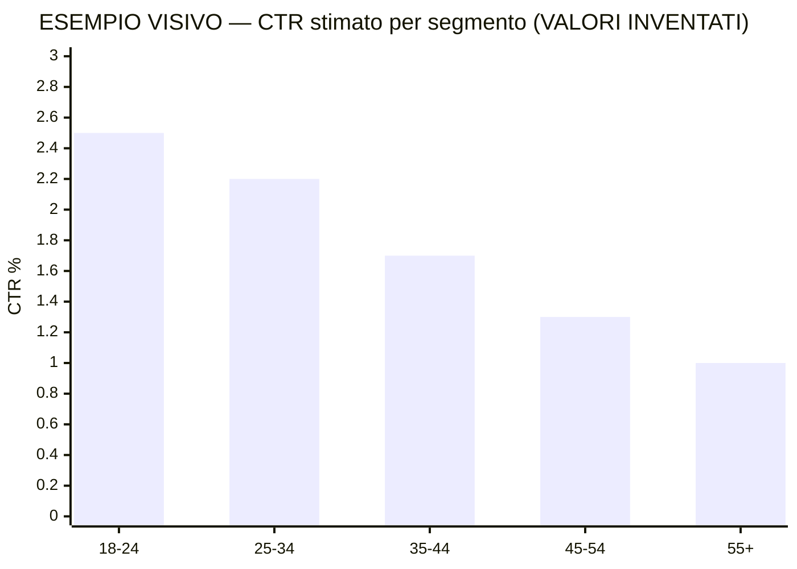
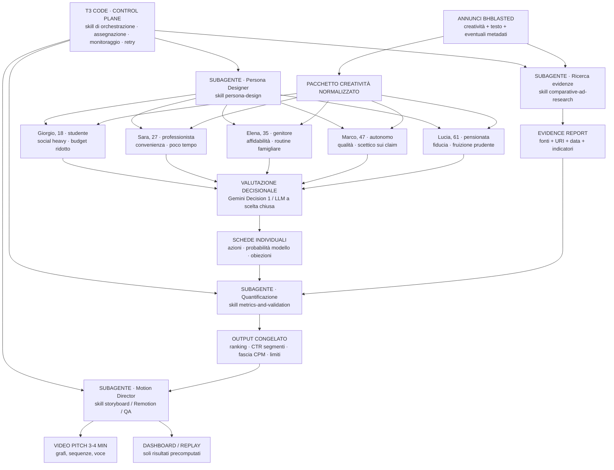
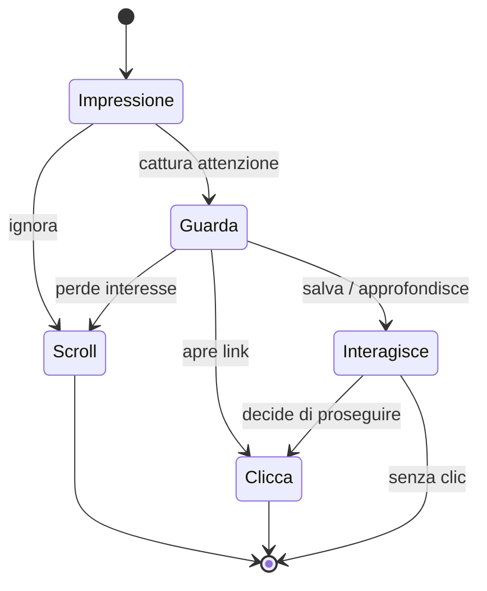
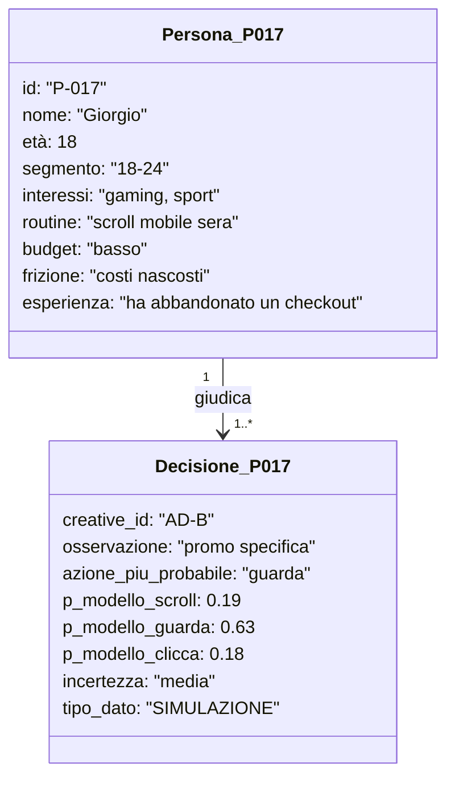
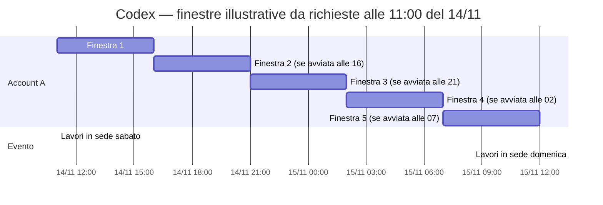
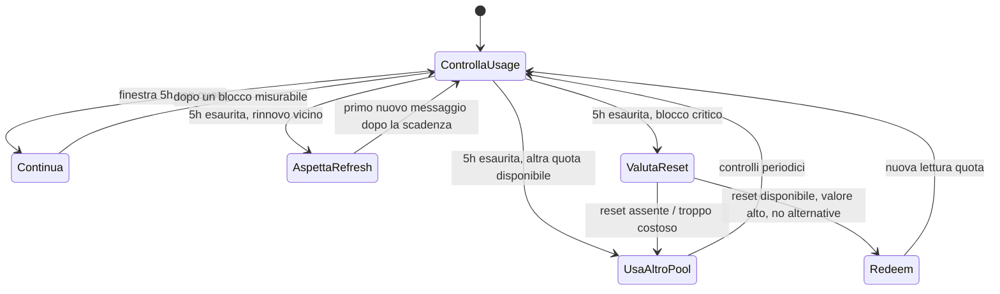
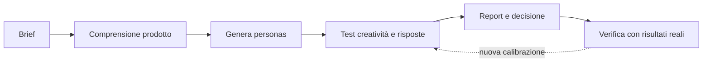
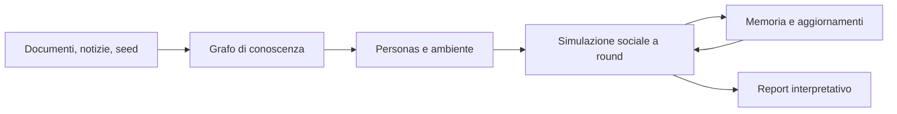

# THE BIG HACK 2026 — CHALLENGE 01 / BHBLASTED
## Specifica tecnica, sperimentale e audiovisiva

**Scopo:** preservare requisiti ufficiali, vincoli, riferimenti, architettura desiderata, criteri di qualità, opzioni di sviluppo e materiali di consegna. Documento tecnico impersonale, utilizzabile come fonte per la successiva redazione di skill e task operative. **Non** costituisce l'implementazione delle skill. Revisione delle informazioni al **14 novembre 2026**.

> [!important] Vincoli non negoziabili
> - **Prodotto principale: motore di analisi e simulazione AI in batch**, non SaaS né web app di inferenza dal vivo.
> - **Le personas AI sono obbligatorie** per attinenza al brief: generazione indipendente dagli annunci, valutazione isolata e risultati per segmenti.
> - Output richiesti: **annuncio vincente, CTR previsto per segmento, fascia CPM, motivazioni**; distinguere numeri osservati, calcolati, stimati e illustrativi.
> - **T3 Code** è il control plane proposto, con skill e subagenti; l'automazione effettiva va verificata nei provider disponibili.
> - **Presentazione:** video pitch con motion design curato + visualizzatore/demo dei risultati *già elaborati*. Nessun obbligo progettuale di fornire inferenza live.
> - **Budget operativo:** abbonamenti Codex e Gemini esistenti + strumenti gratuiti; niente modello locale come pilastro del progetto; API a pagamento escluse dal percorso principale.
> - **Regola metodologica:** più personas non significa necessariamente più accuratezza. La prova quantitativa deve differenziare segnale sintetico, calibrazione e verità osservata.

### Marcatori di certezza

- **[U26]** Testo/agenda ufficiale Big Hack 2026.
- **[P]** Precedente documentato, non norma confermata per il 2026.
- **[V]** Funzionalità verificata nelle fonti pubbliche del servizio/repository; **non** equivale a test sul sistema del team.
- **[D]** Scelta progettuale, stima, esempio o proposta per il prototipo.
- **[?]** Dato, disponibilità, licenza, quota o istruzione ancora non confermata sul posto.

---

## 1. Brief ufficiale e interpretazione strettamente aderente

**[U26] Challenge 01 — «Clienti che non esistono», promossa da Bhblasted.** Sintesi fedele della [pagina ufficiale](https://go.codemotion.com/big-hack-hackathon-2026/): progettare un sistema che utilizzi l'intelligenza artificiale per **simulare un pubblico eterogeneo**, differenziato per età, abitudini e bisogni, e **prevedere le reazioni** a un annuncio prima del lancio. La soluzione deve permettere di selezionare la creatività migliore, identificare il pubblico adeguato, comprendere perché una pubblicità non funzioni. Bhblasted mette a disposizione **annunci reali con esito noto all'azienda ma non al team**; il sistema deve decidere **quale vince**, stimare il **CTR atteso segmento per segmento**, identificare **la fascia del CPM** e giustificare il perché. La frase conclusiva richiede di prevedere meglio e **dimostrarlo su dati reali non visti**.

**Implica cinque deliverable funzionali.**

- [ ] **Personas e audience:** individui sintetici diversificati con contesto, abitudini, bisogni, motivazioni e segmentazione documentata; non sostituibili con un generico «l'LLM valuta l'annuncio».
- [ ] **Confronto delle creatività:** ranking e individuazione del possibile vincitore, anche in presenza di due soli annunci.
- [ ] **Previsioni quantitative:** CTR per segmento e fascia CPM per la campagna, con metodo e provenienza delle ipotesi espliciti.
- [ ] **Spiegazioni causali proposte:** punti di forza, frizioni, differenze tra segmenti; etichettarle come *interpretazioni del modello*, non come cause sperimentalmente dimostrate.
- [ ] **Verificabilità:** predizioni congelate prima di conoscere i risultati reali; confronto quantitativo quando l'organizzazione li rende disponibili.

**[?] Il testo non afferma** che sarà consegnato un dataset storico etichettato, che gli esiti verranno svelati prima della consegna, o che il sistema sarà testato con interazione live. Tutti e tre i punti restano aperti. La progettazione predefinita considera **solo creatività e descrizioni**, con metadati eventuali; dataset storici completi sono uno scenario migliorativo non presunto.

**[U26] Criteri generali della giuria:** utilità/valore; attinenza alla challenge; chiarezza/completezza; design/UX; creatività/innovazione. Non risultano pesi ufficiali pubblicati. L'aspetto competitivo più direttamente verificabile è la pertinenza tra output e brief, non il numero di modelli coinvolti.

### Chi è il committente, nella misura utile al progetto

**Bhblasted** opera nel digital/performance marketing: progettazione, gestione e ottimizzazione di campagne in cui risultati e ritorno sull'investimento hanno particolare rilevanza. Non è necessaria nel pitch una storia aziendale o un profilo individuale dei manager. Il posizionamento deve parlare la lingua di una squadra che gestisce advertising: **decisione pre-lancio, previsione per pubblico, costo atteso, motivazione dell'intervento**. Informazioni ulteriori su persone e ruoli non sono assunte per il 2026. Riferimenti: [sito Bhblasted](https://www.bhblasted.com/), [articolo Codemotion giugno 2025](https://www.codemotion.com/magazine/it/dev-life-it/eventi/the-big-hack-is-back-le-sfide-e-i-vincitori-delledizione-2025/).

---

## 2. Logistica, consegna e documentazione delle edizioni passate

### 2.1 Agenda ufficiale

**Sabato 14 novembre 2026:** 09:00–10:00 accoglienza; 10:00–11:00 partner, challenge e regole; **11:00 inizio lavori**; **20:30 stop lavori in sede**.

**Domenica 15 novembre:** **08:30 ripresa**; **12:00 consegna progetti**; 14:00–15:30 valutazione; 16:00 inizio evento conclusivo; 18:00 chiusura. Circa **13 ore in sede** (9h30 sabato + 3h30 domenica), esclusi pause e checkpoint. Squadre di **2–5 partecipanti**, almeno **due checkpoint obbligatori**; almeno un portavoce presente alla proclamazione. **2.500 € in buoni Amazon** per il team vincitore della sfida. [Pagina evento](https://go.codemotion.com/big-hack-hackathon-2026/).

**[?] Lavoro esterno sabato notte:** il regolamento vieta permanenza/lavoro e pernottamento *in struttura* dopo la chiusura; **non equivale a un'autorizzazione esplicita a proseguire fuori sede**. La pianificazione dispone di un'opzione di elaborazione notturna, da utilizzare soltanto se ammessa nelle istruzioni finali. In ogni caso i progetti devono essere consegnati entro le 12:00.

### 2.2 Formati e modalità precedenti

- **[P] Regolamento 2022:** prevista presentazione tramite video pitch (limite di tre minuti per quella edizione), repository/materiali. [Regolamento 2022](https://2022.thebighack.makerfairerome.eu/en/rules/).
- **[P] Regolamento 2023:** form con titolo, logo, descrizioni, parole chiave, materiale e **video pitch max 3m30s** per quella edizione. [Regolamento 2023](https://2023.thebighack.makerfairerome.eu/regolamento/).
- **[P] Giugno 2025:** [pagina ottava edizione](https://events.codemotion.com/hackathons/the-big-hack-2025-ottava-edizione/faq), [resoconto vincitori](https://www.codemotion.com/magazine/it/dev-life-it/eventi/the-big-hack-is-back-le-sfide-e-i-vincitori-delledizione-2025/), [Campania NewSteel con materiali](https://www.campanianewsteel.it/the-big-hack-2025-team-vincitori/).
- **[P] Ottobre 2025:** [pagina Special Edition](https://events.codemotion.com/hackathons/the-big-hack-2025-special-edition/faq), [resoconto Maker Faire](https://makerfairerome.eu/blog/blog-the-big-hack-special-edition-2025-vincitori-napoli/), [Campania NewSteel con video](https://www.campanianewsteel.it/the-big-hack-special-edition-team-vincitori/).
- **[U26] Novembre 2026:** l'agenda indica submission e sessione di valutazione in orari differenti, ma **non pubblica un formato di consegna definitivo, una durata obbligatoria del pitch né l'esistenza di un pitch sul palco**. Il video da 3–4 minuti è un *master progettuale*: predisporre anche esportazioni brevi qualora il limite sia inferiore.

### 2.3 Vincitori osservabili, cosa è e non è dimostrato

**Giugno 2025 · AdGenius · Bhblasted.** Presentazione video con bot Telegram e dashboard; il progetto era un agente per esaminare campagne, report e raccomandazioni di ottimizzazione. [Video AdGenius](https://drive.google.com/file/d/18F2IIrgesSgpxom-PKDaCFyVPqsbvPjz/view) · [resoconto Codemotion](https://www.codemotion.com/magazine/it/dev-life-it/eventi/the-big-hack-is-back-le-sfide-e-i-vincitori-delledizione-2025/). **Osservazione del team sul filmato:** narrazione artificiale poco naturale, demo presente ma difficoltà a interpretare i numeri, ritmo migliorabile. **Non è noto** se questa sia la ragione del successo o come fossero i progetti concorrenti.

**Ottobre 2025 · ADFLOW · Bhblasted.** Workflow n8n con agenti AI e componenti Python per automatizzare campagne multi-piattaforma. [Video ADFLOW (~3m57s)](https://www.canva.com/design/DAG20b5aXhk/g7KIClctVi2Vtv2XzwlheQ/watch?utlId=hcdab62b4ae) · [progetti vincitori](https://www.campanianewsteel.it/the-big-hack-special-edition-team-vincitori/). **Osservazione del team:** spiegazione ricca ma molto tecnica, densità eccessiva, direzione audiovisiva non sempre efficace. **Non è verificato** quali integrazioni funzionassero interamente in produzione.

**Altri precedenti utili:** **FactoryMind** (pipeline analitica/predittiva industriale), **Quman** (workflow sperimentale di elaborazione), **5Detect** (concept per un brief che esplicitamente non richiedeva software finito), documentati nel [recap ottobre 2025](https://www.campanianewsteel.it/the-big-hack-special-edition-team-vincitori/). **Nessun precedente dimostra** che una simulazione non implementata sia sufficiente per la specifica Bhblasted 2026.

### 2.4 Partecipanti e pressione competitiva

**Fatti:** l'edizione di **giugno 2025** ha riportato circa **130 partecipanti** ([Codemotion](https://www.codemotion.com/magazine/it/dev-life-it/eventi/the-big-hack-is-back-le-sfide-e-i-vincitori-delledizione-2025/)); l'edizione di **ottobre 2025** ha registrato **235 partecipanti, 50 team, 7 challenge** ([Maker Faire](https://makerfairerome.eu/blog/blog-the-big-hack-special-edition-2025-vincitori-napoli/), [post Codemotion](https://www.linkedin.com/posts/codemotion_thebighack2025-activity-7388514931203104768-Lqqa/)). Nessuna ripartizione per challenge 2026 verificata.

**[D] Modello puramente esplorativo, se partecipassero 50 team a 5 challenge:** 10/team come media aritmetica non è una previsione. Un possibile scenario di distribuzione: **Bhblasted 12 · Meditech 10 · Mare Group 7 · Consorzio Clara 9 · Fastweb/Vodafone 12**. Il numero effettivo può essere molto diverso. Simulazioni a 30 e 60 team complessivi porterebbero una media generica di 6 e 12 team per sfida.

**Perché queste attrattività ipotetiche:**

- **01 Bhblasted — «Clienti che non esistono».** LLM, mercato, personas e forecasting: ingresso relativamente accessibile a team generalisti AI, ma *valutazione quantitativa* più difficile. Competitor probabili: survey simulate, semplici prompt persona, dashboard con risultati non calibrati. Differenziazione: modello decisionale mirato, isolamento, fonti verificate, confronto predittivo e narrazione chiara.
- **02 Meditech/M.O.D.A.L. — sostenibilità/energia/ambiente/agrifood.** Perimetro ampio, accessibile a proposte data-driven e idee concettuali; richiede però legame tra benefici e utilizzo concreto. Potenziale numero medio-alto di team generalisti, ma dispersione in tre sottodomini.
- **03 Mare Group — FieldVision.** Tracking visivo con occlusioni, incertezza, feedback e latenza; barriera tecnica relativamente elevata in CV/realtime. Platea potenzialmente più selezionata, senza dati reali.
- **04 Consorzio Clara — Hack the Route.** Serious game cybersecurity/networking; attrattivo per sviluppatori web e videogame, visualmente dimostrabile, richiede esperienza interattiva credibile.
- **05 Fastweb + Vodafone — Napoli Agentic City.** Multiagent orchestration per servizi urbani, tema ampio e molto naturale per prototipi LLM; concorrenza potenzialmente elevata tra agent-builder. Servono effetti concreti misurabili.

**Posizionamento desiderato:** non «un altro sistema che mette tanti agenti a discutere», ma **laboratorio decisionale pre-lancio**: esperimenti controllati, giudizi indipendenti, metriche comparabili e scelte economicamente leggibili.

---

## 3. Output da produrre e criterio di completezza

### 3.1 Checklist dei quattro blocchi fondamentali

**A. Audience / personas e comportamento [OBBLIGATORIO]**
- [ ] Segmenti caratterizzati per età, routine, bisogni, interessi, familiarità col canale, vincoli economici.
- [ ] Generazione delle schede **prima** della lettura della creatività; profili identici nei diversi test A/B.
- [ ] Valutazioni isolate: `scroll / guarda / interagisce / clicca` con ragioni sintetiche e gradi di incertezza.
- [ ] Variazione del prompt, dell'ordine delle creatività e, ove fattibile, del provider; registrazione di eventuali sostituzioni.
- [ ] Aggregazioni per segmento e differenze tra giudizi: nessuna affermazione di «rappresentatività» di un pubblico reale.

**B. Ricerca e provenienza dei dati [OBBLIGATORIO]**
- [ ] Per ogni campagna cercare creatività **comparabili per piattaforma, settore, paese, formato, periodo e obiettivo**.
- [ ] Registrare URL, ora di raccolta, fonte, criteri di comparabilità e limiti dell'informazione.
- [ ] Distinguere le metriche **reali osservate**, gli indici **relativi**, le **stime ricostruite** e i valori **non disponibili**.
- [ ] Report CSV/JSON delle evidenze; note descrittive delle somiglianze e differenze.

**C. Modello quantitativo / analitico [OBBLIGATORIO]**
- [ ] Ranking vincitore per le creatività.
- [ ] CTR atteso **segmento per segmento** con specifica del livello di evidenza.
- [ ] Fascia CPM motivata dal contesto e dai benchmark disponibili; non derivata arbitrariamente dalla grafica.
- [ ] Baseline di confronto non-persona; eventuale valutazione blind e analisi dell'errore.
- [ ] Eventuale estensione **Timestral** se disponibili serie temporali autentiche e sufficientemente comparabili.

**D. Comunicazione [OBBLIGATORIO]**
- [ ] Video pitch master **3–4 minuti** con motion design, narrazione naturale (eventuale ElevenLabs), numeri dichiarati e dimostrazione per replay.
- [ ] Visualizzatore/dashboard **dei risultati salvati**, non prodotto SaaS né front-end di inferenza live.
- [ ] Diagrammi, carte persona, grafo delle decisioni, confronti per segmento, metodologia e risultati chiave.
- [ ] Materiale tecnico minimo consegnabile: report, log, codice eseguibile del motore o workflow riproducibile, note sulle limitazioni.

### 3.2 Esempio dell'output atteso a fine challenge — SOLO SIMULAZIONE GRAFICA

> [!warning] I numeri seguenti sono **inventati** e servono esclusivamente a modellare il risultato che la demo dovrà visualizzare. Non sono risultati del sistema né benchmark del mercato.

**Campagna:** app di consegna pasti; creatività A: «Più tempo per te»; creatività B: «Prezzo trasparente, consegna veloce». Piattaforma ipotetica: feed Instagram in Italia, periodo non definito.

**Decisione di ranking:** B supera A in 4 dei 5 segmenti simulati; A è più apprezzata dal segmento 35–44. **Vincitore previsto: B**. Origine: *simulazione AI, non confronto osservato*.

**CTR ipotetico da modello calibrato — SOLO VALORI SEGNAPOSTO:**

**CPM illustrativo:** «8–14 € / 1.000 impressioni», *fascia ipotetica da sostituire*, esplicitando se il valore deriva da benchmark pertinente, dati veri o mera assunzione. **Spiegazione attesa:** «B ottiene attenzione iniziale più alta grazie alla promessa specifica; il costo è il vincolo più ricorrente nei segmenti adulti. La previsione resta incerta finché non viene calibrata su risultati osservati».

**Stato delle evidenze visualizzabile:** `PERSONAS: simulate` · `RANKING: non validato` · `CTR: illustrativo / stimato / calibrato` · `CPM: benchmark / dati partner / non verificabile` · `OUTCOME: nascosto / ricevuto`. In una demo reale non devono comparire valori illustrativi senza evidenti avvisi.

---

## 4. Architettura desiderata: T3 Code come orchestratore padre

### 4.1 Grafo principale

**[D] Responsabilità di T3 Code.** Supervisionare job e contesti, lanciare le subtask, distribuire i provider, recuperare errori e orchestrare l'assemblaggio. **[?] Non presupporre una funzione nativa di T3 Code che crei automaticamente centinaia di thread isolati via skill:** verificare se la versione installata consente subagent spawn, headless task o automazione di sessioni. In alternativa, T3 rimane regia e il fan-out avviene mediante script/CLI dei provider; i file generati rappresentano il contratto tra attori.

### 4.2 Confini informativi delle skill (da implementare, non incluse)

**`persona-design` — definizione della popolazione sintetica.** Legge: dominio, paese/canale solo se noto, tassonomia dei segmenti, target esplicito del brief, vincoli di diversità, seed. **NON legge:** immagine o copy dell'annuncio da giudicare, valutazioni di altri attori, CTR reali o vincitori. Produce: `persona_id`, età, genere se rilevante e noto, interessi, avversioni, budget indicativo, uso piattaforma, abitudini, esperienza precedente con la categoria, motivazioni, ambiguità. Scarta duplicati di archetipi e stereotipi rigidi. La diversità di genere **non** giustifica assunzioni automatiche sulle preferenze.

**`persona-actor` — valutazione isolata della creatività.** Legge: **solo** propria scheda persona, eventuale contesto del feed, annuncio mostrato, scelta comportamentale neutra e ordine randomizzato A/B. **NON legge:** valutazioni di altri agenti, ranking globale, obiettivo di far vincere un annuncio, tassi reali, analisi di ricerca che potrebbero primare la risposta, statistiche aggregate. Produce: azione e probabilità/score di modello, decisione, motivazione breve, evidenza presente nella creatività, fattore di incertezza. Le istanze non comunicano finché i risultati non vengono congelati.

**`comparative-ad-research` — ricerca di campagne assimilabili.** Legge: creatività, testo, prodotto, piattaforma/paese/formato/periodo/obiettivo disponibili. **NON legge:** risultati nascosti di Bhblasted né giudizi delle personas, per non confermare selettivamente una decisione già presa. Produce: `source`, URL, tempo, criterio di similitudine, dati esposti, tipo di metrica, eventuale numero **osservato**, affidabilità e limiti; CSV + sintesi. Non trasforma *top X% CTR* in CTR percentuale assoluta.

**`metrics-and-validation` — trasformazione quantitativa.** Legge: risposte congelate, segmenti, pesi target, evidenze esterne, eventuali etichette di *training* rilasciate. **NON legge:** risultati finali nascosti sino al freeze di previsione. Produce: ranking, CTR per segmento, CPM fascia e relativa provenienza, comparazione baseline, metodologie e analisi di sensibilità. Non crea numeri inventati nei campi metrici.

**`motion-director` — visualizzazione.** Legge: output congelati, schede approvate, storyboard, font e linee grafiche, media autorizzati. **NON può:** ricalcolare, modificare o abbellire le metriche. Produce: sequenze audiovisive e visualizzatore dei risultati. Se i dati risultano deboli, mostra i limiti invece di ometterli.

### 4.3 Segmenti e dimensione del campione sintetico

**Disegno iniziale [D]:** cinque gruppi di età **18–24, 25–34, 35–44, 45–54, 55+**. All'interno di ciascuno: differenziare rapporto col prodotto, disponibilità economica, frequenza d'uso del canale, livello di fiducia, livello di interesse, esperienza di acquisto. Il **target reale** può suggerire altri assi più informativi dell'età; usare sesso/genere o altre caratteristiche soltanto in modo pertinente, rispettoso e non stereotipato. Se il brief contiene una segmentazione diversa, prevale quella del partner.

- **Pilot minimo:** **5 segmenti × 3–4 personas = 15–20 personas**, confrontando **2 creatività**: **30–40 valutazioni persona×annuncio**, più chiamate di generazione/sintesi. Scopo: verificare formati, latency, quota consumata e divergenza.
- **Run principale:** **5 × 6–8 = 30–40 personas**. Con **2 creatività**, **60–80 valutazioni**; con 3 creatività, 90–120. Non equivale a 60–120 chiamate API: **Gemini Decision 1 aggrega più domande per un *medesimo* input**; un LLM generativo può invece richiedere più turni. Numero di richieste e durata vanno **misurati dal pilot**.
- **Run esteso condizionale:** **5 × 12–20 = 60–100 personas** se c'è quota libera, senza compromettere ricerca, quantitativa e video. È preferibile ripetere una selezione con provider/ordine diversi piuttosto che moltiplicare profili quasi identici.

**Distribuzione temporanea del compute per *attività* [D], non per numeri di token garantiti:** ~**35–45%** personas/decisioni, **20–25%** ricerca, **15–20%** quantitativa e validation, **15–20%** motion/pitch/integrazione. Queste quote sono **budget di lavoro** da revisionare dopo pilot; soprattutto Decision 1 può ridurre drasticamente il costo relativo delle decisioni, lasciando più risorse alla ricerca e al video.

### 4.4 Come si manifesta la decisione dell'attore

**Rischio:** i punteggi e le probabilità di un modello decisionale misurano la sua **confidenza sulla classificazione proposta nel contesto del prompt**, non la probabilità frequentista che un individuo reale clicchi su una impressione pubblicitaria. Neppure un funnel `P(guarda) × P(clicca|guarda)` è CTR reale senza calibrazione empirica.

### 4.5 Scheda individuale e output in Mermaid *non flowchart*

*Valori di probabilità esclusivamente inventati per visualizzare lo schema di una scheda; non stime da Decision 1.* Specificare nella vera scheda `model`, `provider`, `prompt_version`, `time`, `order`, `source_of_features` e, se disponibili, scores per ogni opzione. Per il video: una carta persona si apre, compaiono un annuncio e tre possibili azioni; la decisione scelta si illumina; la carta confluisce nel grafo del segmento.

---

## 5. Gemini Decision 1 e alternativa generativa

### 5.1 Il modello corretto e perché è pertinente

**[V] Google ha rilasciato `gemini-decision-1` l'11 novembre 2026** assieme alla **Gemini Decisions API**. Non è un modello generativo che scrive una spiegazione: valuta domande **sì/no, choice (2–255 opzioni), score su rubriche ordinate** e restituisce probabilità/confidenza. Google annuncia fino a **1.000 domande** su un input multimodale condiviso in un passaggio, latenza indicativa **150–250 ms end-to-end**, prezzo **$0,10 / 1 milione di token input** e nessun costo per token output. Esiste un **tier API senza costo per prototipi in AI Studio**; RPM/RPD effettivi e disponibilità per account vanno letti in AI Studio, non desunti dalla pagina di marketing. [Annuncio Google 11/11/2026](https://blog.google/innovation-and-ai/technology/developers-tools/gemini-decisions-api/) · [Google Codelab discriminative models](https://codelabs.developers.google.com/codelabs/discriminative-models) · [rate limits](https://ai.google.dev/gemini-api/docs/rate-limits).

**Uso corretto nel progetto:** lo stato condiviso di ogni decisione può contenere **scheda di una persona + creatività**; domande separate valutano `scroll`, `guarda`, `clicca`, `credibilità`, `chiarezza`, `sensibilità prezzo`. **La capacità «1.000 domande» non significa «1.000 personas isolate»**. Se tutte le personas venissero inserite nello stesso contesto si perderebbe l'isolamento desiderato; utilizzare input distinti per persona o dimostrare formalmente l'assenza di contaminazione.

**Importante per il budget:** il tier gratuito della **Gemini Developer API** è un pool separato dalle quote di utilizzo dell'interfaccia/abbonamento Gemini Antigravity. L'abbonamento Google non garantisce da solo un numero particolare di chiamate alla Decisions API.

### 5.2 Strategia a due livelli

**[D] Percorso principale, se Decision 1 è accessibile gratuitamente:**

1. Un LLM generativo produce la scheda biografica sintetica e registra vincoli e storia.
2. `Gemini Decision 1` legge persona + singola creatività e restituisce scelte/probabilità su domande strutturate.
3. Un LLM leggero costruisce una motivazione **partendo dai campi congelati**, senza riscrivere il risultato decisionale.
4. Un modulo deterministico aggrega per segmento e calcola ranking/indici; un modulo calibrato stima CTR solo se ha dati adeguati.

**[D] Fallback completamente senza Decisions API:** usare il modello generativo già disponibile (Gemini 4 Hydrogen oppure GPT-6 Luna / Terra) con output JSON rigoroso su `scroll|guarda|clicca|salva`, score e motivazione. Rilevare violazioni dello schema, sensibilità al prompt e variazioni di risultato. Nessuna pretesa di calibrazione dei suoi confidence numerici.

**[D] Variante di controllo:** un solo modello generativo giudica la creatività **senza persona**. Confrontare il suo ranking con il panel simulato; se vince la baseline, riportarlo correttamente. La ricerca pubblica di MarketMirror mostra un primo benchmark in cui il panel di 10 personas non ha battuto il prompt senza persona: [repo e RESULTS.md](https://github.com/DarkWorldCoder/market-mirror).

---

## 6. Ricerca comparativa gratuita: che dati arrivano davvero?

**Priorità:** raccogliere *evidenze verificabili*, non produrre quantità massicce di pagine senza metriche. Nessun crawler è autorizzato a chiamare «CTR reale» un punteggio o a ricavare un CPC da like/follower. Operare entro condizioni d'uso e quote; evitare bypass, aggiramento di blocchi e scraping di dati privati.

### 6.1 Meta Ad Library — gratuito per creatività; API ufficiale limitata

**[V]** [Meta Ad Library, consultazione](https://www.facebook.com/ads/library/): ricerca degli annunci attivi e degli annunci EU/UK coperti dalle finestre di trasparenza; creatività, pagina, periodo, piattaforme. [Meta Ad Library API](https://www.facebook.com/ads/library/api/) comprende in particolare annunci politici nel mondo e annunci di ogni tipo distribuiti in UE/UK, **richiede registrazione/specifiche autorizzazioni** e non è un'API generica dei CTR delle inserzioni commerciali. Per i commerciali EU Meta può pubblicare *impressioni stimate*, non clic o CTR assoluto. [Specifica ufficiale Meta](https://developers.facebook.com/docs/graph-api/reference/ads_archive/).

**[V]** [Meta Ads Insights API](https://developers.facebook.com/docs/marketing-api/insights/v2.5/) espone **impressioni, spesa e metriche reali** *per account/campagne cui si possiedono permessi* (`ads_read`). Non offre dati degli inserzionisti concorrenti. **Gratis:** consultazione web e potenzialmente API dopo autorizzazione; **non garantito utilizzabile immediatamente in hackathon**. Dato utile ricavabile: formato creativo, presenza pubblicitaria, attributi di targeting trasparenti; **CTR/CPM di terzi: no**.

### 6.2 TikTok Creative Center / Top Ads — segnali relativi, non reporting completo

**[V]** [TikTok Top Ads](https://ads.tiktok.com/business/creativecenter/inspiration/topads/pc/en) consente filtri per regione, settore, obiettivo, periodo e ordinamenti per CTR; il [manuale ufficiale](https://ads.tiktok.com/resources/help/article/how-to-use-the-top-ads-dashboard?lang=it) precisa che **senza login si vedono solo cinque annunci**. [Scheda ufficiale](https://ads.tiktok.com/business/library/NA_Creative_Center_Top_Ads_One_Pager.pdf): grafici frame-by-frame con punteggi **indicizzati 0–100**, non CTR assoluti. La [vetrina](https://ads.tiktok.com/creative/creativeCenter) presenta talvolta indicatori tipo «Top 10% CTR», cioè *posizionamento relativo*, non CTR=10%. Anche il campione degli annunci «Top» è selezionato, non rappresentativo.

**Gratis:** navigazione e ordinamenti nel sito (con accesso e limiti); **[?] non risulta un'API pubblica gratuita ufficiale generalista per scaricare CTR e CPM delle Top Ads.** Dati utili: confronto di creative, hook, pattern visuali, classi relative di performance, dinamica temporale *dentro il video*; inutilizzabili come storico quantitativo universale di costo e click.

### 6.3 Google Ads Transparency Center — presenza, non performance

**[V]** [Ads Transparency Center](https://adstransparency.google.com/) permette di cercare annunci di inserzionisti e informazioni di trasparenza. Non è un archivio pubblico di CTR/CPM di ogni campagna. Le metriche di [Google Ads API](https://developers.google.com/google-ads/api/docs/start) sono disponibili con accesso autorizzato agli account: **non ai concorrenti**. Valore per il progetto: comparazione di messaggi e formato; non calibrazione automatica di CTR.

### 6.4 Altre fonti accessibili, con limiti

- **[V] Dataset Criteo**: esempi di click/non click etichettati, ma feature perlopiù anonimizzate e non collegate alle creatività proposte. [Criteo AI Lab](https://ailab.criteo.com/download-criteo-1tb-click-logs-dataset/). Utile solo per test di metodi CTR tabulari; non trasferisce meccanicamente risultati a banner arbitrari.
- **[V] Upworthy Research Archive:** test A/B di titoli con click reali. [Repository/risorse](https://osf.io/jd64p/) — benchmark di confronto ranking, *non* database pubblicitario CPM di Meta.
- **[D] Motori e pagine web pubbliche**: recensioni, annunci concorrenti, landing page e claim verificabili; aiutano a capire prodotto, mercato e opposizioni del pubblico, **non** danno click/impression speso.
- **[?] Dati forniti da Bhblasted:** potranno prevalere su tutto il resto se contengono impression, click, spend, campagna/country/platform/date. Non presumere che siano presenti.
- **Piattaforme a pagamento (Apify, aggregatori adv, proxy, scraping-as-a-service):** **non inserite nel percorso principale**; considerabili solo su conferma di necessità, budget e prova di output che sia *realmente* una metrica osservata. Nessun provider a pagamento è prerequisito.

### 6.5 Regole per l'evidence report

Ogni record dovrebbe contenere almeno `campaign_id`, `reference_creative_id`, `source_name`, `source_url`, `captured_at`, `channel`, `country`, `format`, `time_period`, `similarity_reason`, `metric_name`, `metric_value`, `metric_unit`, `metric_type = observed|relative|estimated|unavailable`, `access_cost`, `notes`. Un CSV separa le righe; un rapporto discorsivo spiega perché una pubblicità è comparabile e che cosa **non** si può inferire. Un riferimento con stessa estetica ma diverso paese/periodo/obiettivo **non** è un benchmark quantitativo automaticamente idoneo.

---

## 7. Quantificazione: output, inferenza e possibilità Timestral

### 7.1 Tre livelli espliciti di fiducia

**Livello A — Annuncio e copy soltanto (DEFAULT).** Disponibili persone sintetiche, segnali relativi di scelta e osservazioni qualitativo-competitive. **Soluzione:** ranking A/B e motivazioni; CTR per segmento e CPM richiesti devono comparire con **assunzioni e incertezza dichiarate**, oppure «non verificabile» se manca ogni dato di riferimento. Preferire benchmark pubblici datati, con piattaforma/paese/obiettivo coerenti, a un numero inventato. Non presentare una simulazione LLM come rilevazione statistica umana.

**Livello B — Annuncio + metadati (PROBABILE POSSIBILITÀ).** Piattaforma, paese, obiettivo, fascia età, posizionamento, budget o periodo permettono confronto più plausibile con esempi pubblici e baseline di mercato. Le inferenze restano *condizionate* dalle ipotesi.

**Livello C — Dataset etichettato reale (UPGRADE, NON PRESUNTO).** Con sufficienti annunci distinti, metriche e segmenti si può introdurre una regressione/modello tabulare semplice, calibrando tassi e intervalli, con split per **campagna** e non righe della stessa creatività. Un piccolo dataset non garantisce fine-tuning affidabile; evitare overfitting e data leakage. Se il test finale resta nascosto, congelare predizioni e hash prima della rivelazione.

### 7.2 Motore matematico minimo

1. Estrarre *feature* osservabili da ogni annuncio: offerta, prezzo, call to action, leggibilità, formato, lunghezza, framing, categoria, piattaforma/paese/periodo se noti.
2. Raccogliere segnali persona neutrali: `skip/watch/click/save`, motivi, incertezza, effetto dell'ordine A/B.
3. Calcolare **ranking descrittivo** e robustezza rispetto a campione, ordine e provider. Non stimare CTR direttamente dalla percentuale di click dichiarati.
4. Se disponibile un *baseline CTR* credibile e un dataset di calibrazione, usare un modello statistico (es. regressione logistica, modello gerarchico semplice, ridge sulle feature, aggregazione pesata). In assenza di dati, mostrare intervalli scenario-based chiaramente ipotetici; il brief pretende una stima, ma l'evidenza non va inventata.
5. Il **CPM** richiede benchmark esterni o dati partner su spesa/impression. **`CPM = 1000 × spesa / impression`** solo se spesa e impression sono osservati. L'asta, la concorrenza, il canale, la stagione e l'obiettivo pubblicitario contano quanto o più della creatività.
6. Validare con outcome mai mostrati a persona-actor o ricercatore; misurare vincitore corretto, errore assoluto CTR (punti percentuali), copertura e larghezza fascia CPM. Comparare con baseline senza personas.

### 7.3 Timestral come elemento opzionale di frontiera

**[V] Mistral Timestral** è una famiglia di modelli per serie temporali annunciata il **15 ottobre 2026**; disponibile in varianti **5M, 28M, 123M, 209M** di parametri con previsioni probabilistiche e covariate. [Annuncio Mistral](https://mistral.ai/news/timestral/) · [modello](https://docs.mistral.ai/models/timestral-1-0-28m) · [repository](https://github.com/mistralai/timestral).

**Usarlo soltanto se** i dati contengono misurazioni *a intervalli nel tempo*, ad esempio CTR/CPC/impressioni giornalieri di campagne comparabili con stagionalità, sufficienti osservazioni e stessa definizione della metrica. Una sola immagine con descrizione **non costituisce una serie temporale**. Niente pipeline locale GPU: qualora si usi una versione CPU/cloud/free demo, prima valutare compatibilità, tempi e termini; nessuna parte essenziale dipende da Timestral. Il nome «frontier forecasting» è comunicativamente utile **solo se il modello produce un risultato reale controllabile e pertinente**.

**Alternativa più razionale quando il dataset non è temporale:** classificazione/ranking con Decision 1, score persona, regressione/calibrazione semplice, confronto robusto con una baseline. «Modello moderno» non equivale a «modello adatto»: spiegare la scelta è un elemento di competenza più convincente del nome in sé.

---

## 8. Pool di modelli e costi computazionali (nessun LLM locale)

### 8.1 Stato delle quote alla redazione — dichiarato dal team, non letto dagli account

- **Codex account A:** **100% residuo settimanale**, finestra cinque ore disponibile.
- **Codex account B:** **90% residuo settimanale**, finestra cinque ore disponibile.
- **Gemini Argon:** **100% residuo settimanale** del pool *Argon*.
- **Gemini altri modelli:** pool settimanale separato; **quantità residua non comunicata**, non assumere 100%.
- **Gemini Decision 1 API free:** potenziale tier gratuito *separato*, **quota RPM/RPD e capacità effettiva non ancora controllate**.
- **Banked resets Codex:** 3 sul mio account uno sull'account di matteo 

### 8.2 Modelli verificati e destinazioni [D]

**Gemini 4 Hydrogen**: rilasciato **12 novembre 2026**; orientato a workflow rapidi con efficienza elevata, utilizzabile per estrazione feature, generazione di personas e spiegazioni sintetiche. Livello di ragionamento **low** di default, **medium** per controlli difficili; **high** solo per eccezioni. [Annuncio Google](https://blog.google/innovation-and-ai/models-and-research/gemini-models/introducing-gemini-4-hydrogen/).

**Gemini 4 Argon**: riservare alle decisioni architetturali difficili, verifiche concettuali, bias audit e supervisione di risultati contraddittori; **non** usarlo per ogni persona. Controllare il pool residuo 57% in Antigravity prima di avviare job lunghi. [Google DeepMind](https://deepmind.google/models/gemini/).

**Codex GPT-6 Luna**: modello economico/rapido per generazione ripetitiva, etichettatura e verifiche schemi; **non presumere** che sia «GPT-6.1 Luna»: la denominazione ufficiale rilevata è **GPT-6 Luna**. **GPT-6.1 Terra**: veloce per codice e task delimitate. **GPT-6.1 Sol**: architettura, modellazione quantitativa, debugging integrativo e audit finale. Livelli **low/medium**, **high** quando il rischio d'errore lo giustifica. I modelli disponibili in T3 vanno verificati localmente: rollout e livelli possono differire. [Guida ufficiale OpenAI](https://help.openai.com/it-it/articles/20001275-chatgpt-work-and-codex) · [scelta modelli](https://developers.openai.com/api/docs/guides/model-selection).

**Gemini Decision 1**: scelta principale per classificazioni chiuse/decisioni delle personas *se e solo se* funziona nel tier gratuito; non richiede temperature/«thinking high» del modello generativo.

### 8.3 Costo stimato di un panel — non inventare «token per persona»

Prima del run completo registrare: n. chiamate di generazione persona, n. decisioni/annuncio, n. elaborazioni spiegazione, token stimati se esposti, tempo wall clock, errori e percentuale quota di provider consumata. Se il pilot di **20 personas × 2 ads** costa, per esempio, **Δ5h=8% su account A** (numero meramente illustrativo), la proiezione lineare di 40 personas sarebbe ~16% *a parità di workflow e modello*. Tutte le proiezioni sono da ricalcolare: i coding agent possono produrre tool call e context growth non lineari.

**Misura prioritaria:** *costo reale per persona×creatività completa*, non numero di chat aperte. Ricerca e ripetizione di analisi costose vanno de-duplicate con cache per hash dell'annuncio; una persona non va reinvocata solo perché si è riaperta T3.

---

## 9. Finestre Codex da cinque ore e banked resets: simulazione pratica

### 9.1 Regole pubblicate, da non confondere

**[V]** Su piani con limite di cinque ore, la **prima richiesta dopo la chiusura della finestra precedente avvia una nuova finestra**; una finestra può esaurirsi in meno di cinque ore in caso di uso intenso. La disponibilità non equivale a «5 ore CPU garantite». [OpenAI — gestione quote](https://help.openai.com/en/articles/20001516-managing-usage-with-gpt-6-astra-in-work-and-codex).

**[V]** Un **banked reset gratuito**, quando presente, è una promozione salvata che può ripristinare la finestra cinque ore e la quota settimanale per i piani idonei. Va applicato manualmente; l'opzione in Usage richiede che **almeno una quota interessata abbia meno dell'80% residuo**, e l'uso automatico delegato al modello richiede una soglia ancora più restrittiva (≤10% sul limite principale). Un reset consumato ripristina al 100% le quote coperte sotto il 100%; la quota già al 100% non riparte. Può cambiare il calendario della finestra e quello settimanale. **Non ci sono banked reset garantiti.** [Documentazione OpenAI sui reset](https://help.openai.com/en/articles/20001498-how-resets-work-in-codex).

**Principio economico:** utilizzare un banked reset con **0% di finestra 5h e 90% di settimanale** restituisce capacità immediata di lavorare, ma spende una risorsa rara per aggiungere soltanto 10 punti alla quota settimanale. Con **0% finestra e 15% settimanale**, lo stesso reset ristabilisce anche 85 punti settimanali: tende ad avere un valore maggiore. **Non significa che il residuo settimanale venga materialmente «buttato»**: l'account torna al 100%; si tratta di valore-opportunità del reset, e della possibilità di attendere il naturale rinnovo della finestra.

### 9.2 Timeline senza reset promozionali, se la prima richiesta avviene alle 11:00

**Non** significa che siano disponibili cinque finestre piene in termini di quota settimanale: è soltanto la **cadenza temporale**, sotto l'ipotesi di inviare una richiesta esattamente alle ore indicate dopo la chiusura. Gli orari reali vanno letti da Settings → Usage, che prevale su ogni simulazione. Se non si opera nella notte, la finestra successiva inizierà alla prima richiesta effettiva, non automaticamente allo scoccare dell'ora.

### 9.3 Sfalsamento dei due account [D]

- **Account A:** prima richiesta **11:00 sabato** → primo rinnovo *potenziale* **16:00**.
- **Account B:** prima richiesta **12:00 sabato** → primo rinnovo *potenziale* **17:00**.
- Se A si esaurisce alle **13:00** ed è fermo fino alle 16:00, trasferire lavoro eleggibile su B, **senza trasferire credenziali, logins o aggirare limiti**. Nel frattempo continuano analisi deterministiche, pulizia dati, elaborazione video e integrazione.
- Se anche B si esaurisce, valutare un **banked reset** sull'account più utile **solo dopo** avere visto stato 5h, settimanale, prossimo rinnovo naturale e numero di reset disponibili. Nessuna strategia usa il reset al 90% settimanale *automaticamente*.

**Pre-attivazione con messaggio alle 06:00:** non offre un bonus automatico di cinque ore. Se la finestra 06:00–11:00 termina senza essere utilizzata e alle 11:00 parte un'altra finestra, il risultato pratico è spesso **identico ad avviare la prima finestra direttamente alle 11:00**, senza guadagno di capacità. La pre-attivazione ha senso **solo** se si intende lavorare davvero prima delle 11 o se serve un allineamento provato per un piano di utilizzo; non inviare messaggi fittizi come strategia principale.

### 9.4 Criterio di trigger di un banked reset

**[?] Il numero di banked resets e le eventuali scadenze non sono noti.** Per sessioni fitte e consumo settimanale per «run da 5 ore» **non esiste una percentuale pubblica garantita**; ipotesi operative come 15–25% per run sono solo esperienze aneddotiche e non basi normative. Tracciare percentuali prima/dopo ogni blocco; decidere sul **dato misurato del proprio account**.

### 9.5 Eventuale lavoro dopo le 20:30 — solo se consentito

In caso di autorizzazione al proseguimento fuori sede, sfruttare il periodo serale per **run già predisposti, ricerca, generazione risultati e prima renderizzazione**. La domenica 08:30–12:00 rimane destinata al controllo delle evidenze, montaggio finale e consegna. In caso di divieto di lavoro esterno, tutte le elaborazioni necessarie devono terminare entro la chiusura di sabato o essere recuperabili domenica mattina; questa possibilità non deve far fallire l'MVP.

---

## 10. Riferimenti open source: loop informativo e materiali visuali

### 10.1 MarketMirror

[Repository](https://github.com/DarkWorldCoder/market-mirror) · [film di lancio di 60 secondi — riferimento prioritario per motion design](https://cdn.jsdelivr.net/gh/DarkWorldCoder/market-mirror@main/docs/video/marketmirror-launch.mp4) · [video verticale](https://cdn.jsdelivr.net/gh/DarkWorldCoder/market-mirror@main/docs/video/marketmirror-launch-vertical.mp4) · [cartella sorgente del film](https://github.com/DarkWorldCoder/market-mirror/tree/main/launch-video) · [dashboard simulazione](https://darkworldcoder.github.io/market-mirror/) · [grafica buyer](https://github.com/DarkWorldCoder/market-mirror/blob/main/docs/images/marketmirror-buyers.svg) · [loop grafico](https://github.com/DarkWorldCoder/market-mirror/blob/main/docs/images/marketmirror-loop.svg) · [pipeline](https://github.com/DarkWorldCoder/market-mirror/blob/main/docs/images/marketmirror-pipeline.svg) · [grafica test](https://github.com/DarkWorldCoder/market-mirror/blob/main/docs/images/marketmirror-tests.svg).

**Lettura del loop:** molte chiamate nella generazione delle persone e durante i test; numero di chiamate **non fisso** e variabile con dimensione del panel, test e modello. Una run interrotta può salvare stati intermedi. Il repo dichiara dati sintetici per il video demo e un primo benchmark su dati reali. **Utilizzo come riferimento, non requisito di importazione integrale**; evitare di replicare framework complessi senza necessità.

### 10.2 MiroFish

[Repository originale](https://github.com/666ghj/MiroFish) · [architettura e grafo](https://github.com/666ghj/MiroFish#readme).

**Lettura del loop:** la simulazione sociale può chiamare LLM più volte per **agente × round × azione**; il costo cresce con numero di personas e round. Utile soprattutto per l'idea visiva del grafo, della memoria e delle interazioni. Per la challenge advertising potrebbe essere superfluo simulare una rete sociale completa: non è necessario mettere le personas in comunicazione fra loro, anzi l'isolamento iniziale è una proprietà desiderata.

### 10.3 Componenti da cui ricavare soltanto il principio

- [OASIS / CAMEL-AI](https://github.com/camel-ai/oasis): ambienti multi-agente in social network simulati; per comprendere round/azioni, non obbligatorio installarlo.
- [Remotion skills](https://github.com/remotion-dev/skills) e [HyperFrames](https://github.com/heygen-com/hyperframes): per rendere il motion design una componente di codice riproducibile.

**Asset visuali remoti suggeriti da tenere come link, non copiare senza valutare licenza/attribuzione:**

---

## 11. Motion design: ranking di skill e strumenti attuali

**Metodo di ordinamento:** idoneità **per film 3–4 minuti con grafo/personas/dati**, non popolarità pura; stars indicative di GitHub osservate nel periodo **12–14 novembre 2026**, soggette a variazioni. Le stelle non certificano qualità e la ricerca non sostituisce una prova di render. Sono distinte **skill** da **framework**.

**1 — `remotion-dev/skills` · circa 4,7–5,0k ★ — migliore base generalista.** [GitHub](https://github.com/remotion-dev/skills) · [documentazione](https://www.remotion.dev/docs/ai/skills). Skill ufficiali per composition, markup, rendering, captions e controllo delle timeline. **Fit: altissimo** per infografiche SVG, grafi, contatori, sequenze per segmento e video da dati JSON. Risultati verificabili: repository con installazione `npx skills add remotion-dev/skills` e esempi/documentazione; **non attribuire automaticamente tutti i suoi esempi alla skill**.

**2 — `Vincentwei1021/video-shotcraft` · circa 11,1k ★ secondo catalogo aggiornato — repertorio di inquadrature.** [Repository originale](https://github.com/Vincentwei1021/video-shotcraft) · [README aggiornato ottobre 2026](https://github.com/Vincentwei1021/video-shotcraft/blob/main/README.md) · [mirror non aggiornato](https://github.com/digitalpublisher/video-shotcraft). La fonte originale riporta **124 shot card / 150 preview selezionate** dall'ultimo refresh; il mirror conserva una versione precedente con **152 ricette/209 preview**. Include camera, reveal, beat sync, SFX e film dimostrativi. **Fit: molto alto per singoli shot premium**, meno adatto come unica skill per un video statistico rigoroso. Il mirror ha **0 stelle**, valore da non confondere con la popolarità dell'originale.

**3 — `heygen-com/hyperframes` · ~83k ★ — framework, non una singola skill.** [GitHub](https://github.com/heygen-com/hyperframes) · [showcase](https://hyperframes.heygen.com/). Rendering deterministico di HTML/CSS/animazioni a MP4, con skill nel repository. **Fit: alto** per motion design grafico; utile anche perché il film MarketMirror è costruito con questa tecnologia. Il numero di stelle si riferisce al *framework*.

**4 — `AbubakrChan/product-launch-motion` · ~444 ★ — skill per look cinematografico.** [GitHub](https://github.com/AbubakrChan/product-launch-motion) · [README e film dimostrativo](https://github.com/AbubakrChan/product-launch-motion#readme). Versione **v2 (ottobre 2026)** con movimento, colpi sonori e motion blur; la versione legacy è più orientata a *explainer* con voce narrante. **Fit: medio-alto**, ma ottimizzata per brevi film promozionali e in origine per Claude; adattamento con Codex/Gemini da verificare.

**5 — `/remotion-video` di TechNomadCode · stelle non verificate — skill comunitaria.** [Release e skill](https://github.com/TechNomadCode/AI-Product-Development-Toolkit/releases/tag/v1.2.0) · [demo e discussione ottobre 2026](https://www.reddit.com/r/claudeskills/comments/1wyvwtj/awesome_claude_code_codex_skill_for_motion_design/). Pipeline proposta: storyboard → approvazione → sequenze → SFX → controllo del render; utile per struttura narrativa. **Fit: alto a livello di metodologia**; popolarità/reliability non verificata con benchmark.

**6 — `jangtrinh/design-os-svg-animation` · stelle non verificate — skill vettoriale.** [GitHub](https://github.com/jangtrinh/design-os-svg-animation) (aggiornamenti novembre 2026). Animazioni SVG deterministiche; **fit: alto per diagrammi di personas, linee, nodi e infografiche**, basso per editing video integrale. Verificare licenza della versione selezionata.

**Riferimenti comunità recenti:** [Reddit 24/10, importanza delle reference e del gusto visuale](https://www.reddit.com/r/ClaudeAI/comments/1xdwfec/how_are_people_making_those_insane_graphic/); [Reddit 07/11, Remotion e cattura di interfacce](https://www.reddit.com/r/claudeskills/comments/1xq5uyb/whats_the_best_skill_out_there_for_creating/); [Reddit 03/11, beat sheet e revisione scena per scena](https://www.reddit.com/r/ClaudeDesign/comments/1xmpnpc/first_motion_graphics_video_made_using_claude/); [Reddit 11/11, sottotitoli sincronizzati a parole con ElevenLabs](https://www.reddit.com/r/ClaudeCode/comments/1xt3hoh/web_designer_zero_after_effects_built_a_claude/). Queste sono **esperienze degli autori**, non risultati di test indipendenti.

### 11.1 Direzione visiva della demo

**Obiettivo narrativo:** rendere visibile un processo difficile, non mostrare finestre di chat T3 Code. Linguaggio «esperimento, pubblico sintetico, decisione indipendente, prova quantitativa». Parole chiave suggerite *da usare solo dove corrispondenti all'implementazione*: **BLIND AUDIENCE / INDEPENDENT PERSONAS / MULTIMODAL DECISIONS / EVIDENCE LAYER / SEGMENT-LEVEL FORECAST / PREDICT BEFORE SPEND / OUT-OF-SAMPLE CHECK**.

**Proposte di frame principali** (reference originali da generare in chat; il video finale dovrà animarle):

1. **Input / audience graph:** card della creatività sul lato sinistro; fan-out di 5 segmenti e 30–40 card sintetiche; colore diverso per ogni segmento. *Messaggio: un annuncio, prospettive eterogenee*.
2. **Decision engine:** zoom su una persona; carta biografica (routine/interessi/esperienze), creatività al centro, tre possibili azioni `SCROLL`, `WATCH`, `CLICK` con barre probabilistiche. Label «Gemini Decision 1» **solo se effettivamente utilizzato**. *Messaggio: giudizio indipendente a opzioni chiuse*.
3. **Data / evidence layer:** colonne per Meta/TikTok/Google, fonti e qualità metrica, condotti che convergono in *observed / relative / estimated*. *Messaggio: i dati non vengono confusi*.
4. **Prediction & proof:** segmenti con grafico CTR previsto, fascia CPM e annuncio vincitore; livello di evidenza visibile; linea «prediction locked» prima dell'eventuale «actual revealed». *Messaggio: risultato misurabile*.
5. **Ending card:** principio del prodotto + headline + esito realmente dimostrato, senza risultati inventati.

**Look aggiornato [D]:** 16:9, palette di base bianca/nero con un singolo accento viola; grafica vettoriale piatta, senza neon o grandi gradienti; grandi numeri, geometrie di rete, carta «persona», grafici puliti, spaziature ampie. Tipografia sans moderna, titoli <=7 parole per frame. Assenza di grandi screenshot di chat, griglie illeggibili e pagine di codice. Motion fluido, nodi discreti, transizioni intenzionali. Loghi commerciali solo se corretti e senza implicazione di partnership/certificazione.

### 11.2 Storyboard e narrazione 3–4 minuti (ipotesi modulare)

**00:00–00:20 — PROBLEMA:** creatività A/B su sfondo neutro; domanda grande. Voce: «Prima di investire in una campagna, una scelta rimane incerta: quale messaggio funzionerà, per chi, e a quale costo?»

**00:20–00:45 — IDEA:** grafo di audience e card. «La soluzione costruisce un pubblico sintetico, eterogeneo e controllabile. Ogni profilo possiede abitudini, esperienze e motivazioni differenti.»

**00:45–01:15 — BLIND PERSONAS:** reveal dell'isolamento tra stanze/nodi. «I profili vengono definiti senza conoscere le creatività. In seguito, ogni persona valuta l'annuncio senza leggere i giudizi delle altre.»

**01:15–01:40 — DECISION ENGINE:** zoom su scroll/watch/click, motore specifico se usato. «Modelli specializzati trasformano le reazioni in decisioni strutturate, con probabilità del modello e obiezioni leggibili. Non vengono confuse con clic osservati.»

**01:40–02:10 — EVIDENCE:** blocchi di ricerca, source badges. «Una seconda pipeline ricerca annunci e segnali pubblici comparabili. Distingue ciò che le piattaforme mostrano davvero da ciò che rimane soltanto un'ipotesi.»

**02:10–02:50 — FORECAST:** grafico CTR a segmenti, CPM, ranking. «I segnali vengono aggregati per pubblico e combinati con le evidenze disponibili. Il risultato è una classifica delle creatività, una stima del CTR per segmento e una fascia CPM motivata.»

**02:50–03:15 — VERIFICA:** prediction freeze e reale; mostrare solo ciò che è stato effettivamente fatto. «Le previsioni vengono congelate prima del confronto con i dati reali. Dove esiste una verifica, sono mostrati anche gli errori; dove non esiste, i limiti restano visibili.»

**03:15–03:40 — CHIUSURA:** singola outcome card e logo del progetto. «Non un'altra dashboard pubblicitaria, ma un motore di sperimentazione pre-lancio: molte prospettive, un confronto trasparente, decisioni migliori da sottoporre alla prova dei dati.»

**[?] Il limite reale sarà comunicato dagli organizzatori.** Preparare un taglio ≤3:00 rimuovendo dettagli di metodo e comprimendo i passaggi 01:15–02:10; **non** tagliare la parte sul risultato. ElevenLabs può fornire una voce naturale in italiano (con eventuale versione inglese), ma disponibilità API e crediti restano soggetti all'account. Nessuna API voce è un vincolo essenziale: voce umana registrata è fallback. Musica strumentale con licenza chiara, sempre sotto la narrazione; preferire effetti sobri a sottofondi invadenti. Il testo e i frame devono essere sincronizzati con l'audio, non viceversa.

### 11.3 Dashboard come elemento scenico, non prodotto live

Una **pagina di replay** mostra: creatività selezionata, carta persona e comportamento, grafo di interazioni isolato, matrici per segmento, provenance strip, ranking/CTR/CPM, numero di valutazioni e job id. Nessun pulsante «avvia nuova inferenza» obbligatorio. Eventuali click sono **navigazione di dati precomputati**. Mostrare un job già terminato è corretto se etichettato come *run registrato / replay*. Non simulare un'inferenza live mai avvenuta.

---

## 12. Rischi, trigger e alternative condizionali

**Se Bhblasted consegna *solo immagini e copy*** → avviare generazione segmenti e test indipendente A/B; raccogliere fonti creative comparabili; produrre ranking, motivazioni, una stima CTR con benchmark e assunzioni fortemente evidenziate; fascia CPM indicativa condizionata a paese/canale, o stato «non stimabile con evidenza sufficiente». **Non** addestrare un modello su dati assenti.

**Se consegna anche paese, canale, pubblico, budget/periodo** → specializzare le personas, restringere ricerche TikTok/Meta, scegliere benchmark CPM pertinenti; usare tali metadati per CTR relativo; confrontare i gruppi d'età richiesti.

**Se consegna uno storico di click, impressioni, spesa** → calcolare CTR/CPM reali per dati di train, lasciare test finale escluso; addestrare/calibrare un modello semplice, verificare generalizzazione. Attivare Timestral **solo** in presenza di serie temporali con granularità adeguata.

**Se il sistema non può chiamare Gemini Decision 1 gratuitamente** → decisioni tramite LLM generativo Codex/Gemini con schema JSON e opzioni chiuse, registrando modello e temperatura/effort. Non perdere ore a ottenere accessi speciali.

**Se T3 Code non consente fan-out automatico** → usare sessioni coordinate manualmente o job/script CLI sottostanti; T3 gestisce task e raccolta output; contratti JSON e isolamento contesti rimangono invariati.

**Se il panel restituisce giudizi ripetitivi** → migliorare assi di segmentazione e biografie *prima* di aumentare N; confronto tra provider/order e diversità qualitativa; non gonfiare artificialmente le risposte per creare «consenso».

**Se non si trovano CTR reali pubblici dei concorrenti** → rimuovere quell'obiettivo dal data collector, non cambiare fonte per far apparire un numero; utilizzare TikTok Top Ads come ordine/percentile relativo, Meta come riferimento creativo e dati del partner se rilasciati.

**Se i conti delle quote sono insufficienti** → ridurre panel a 15–20 personas, 2 creatività, una decisione strutturata a persona per annuncio; scegliere un solo provider per run e conservare la baseline; congelare dati e deviare la quota restante al video.

**Se non è autorizzato il lavoro notturno fuori sede** → MVP concluso entro sabato 20:30 e domenica solo packaging. **Se autorizzato** → batch completo/notturno ma render finale e backup entro domenica mattina.

**Se la giuria richiede una demo dal vivo** → mostrare **replay di un job vero** più log di esecuzione e file; eventuale test piccolo ad hoc solo se tempi/connessione lo consentono, senza affermare che l'intero run sia appena terminato.

**Se la valutazione è soltanto su video/repository** → privilegiare risultato finale, proof/data lineage, storyboard, voce, sintesi e riproducibilità del motore; non costruire frontend di inferenza.

**Se il risultato reale della campagna non viene mai rivelato prima della consegna** → niente claim di accuratezza sul test nascosto; inserire protocollo di validazione blind e, se disponibile, benchmark indipendente su altri dati senza leakage.

---

## 13. Checkpoint, MVP e pianificazione a margine flessibile

### Sabato 11:00–20:30 — requisiti minimi entro la chiusura in sede

- [ ] Brief ufficiale e metadati effettivamente consegnati acquisiti; output dichiarato per ogni campagna.
- [ ] Control plane T3 Code operativo o fallback CLI, con separazione delle sessioni.
- [ ] Skill *specificate* nei confini, anche se non ancora completate; generator personas isolato dal materiale pubblicitario.
- [ ] **Un'esecuzione end-to-end reale**, almeno 2 creatività, 15–20 personas, risultati conservati.
- [ ] Decisioni in forma strutturata e report per almeno 3–5 segmenti, distinguendo output simulati e dati osservati.
- [ ] Report di ricerca con almeno alcune fonti autentiche e URL; chiaro se mancano CTR/CPM misurati.
- [ ] Ranking, **bozza CTR per segmento** e **logica CPM** disponibili, anche se da migliorare; nessuna metrica mascherata da osservazione.
- [ ] Materiale video minimo: scene centrali abbozzate e storyboard stabile; **prima esportazione leggibile / piano di montaggio**.
- [ ] Backup dei risultati e stato quota per entrambi gli account.

### Domenica 08:30–12:00 — completamento

- [ ] Migliorare/estendere panel soltanto se fa guadagnare evidenza e non mina la consegna.
- [ ] Validare ove possibile e congelare le predizioni con timestamp e identificatore univoco.
- [ ] Montare/masterizzare il video nei limiti reali, registrare o sintetizzare la narrazione.
- [ ] Stabilizzare la dashboard di replay e verificare che tutti i numeri coincidano con i report.
- [ ] Preparare ZIP/link/repo/materiali richiesti dalla piattaforma comunicata.
- [ ] Consegnare **prima delle 12:00**, lasciando margine per eventuali upload/connessione.

**Priorità di rilascio:** (1) correttezza del brief e personas, (2) dati e output quantitativo onesto, (3) risultati congelati/leggibili, (4) video efficace, (5) grafiche e optional. Nessun elemento «premium» giustifica il mancato rispetto di un output ufficiale.

### Mentor: domande per ottenere un vantaggio informativo, non per farsi ripetere il brief

- «Per un forecast pre-lancio, la giuria preferirà la **correttezza della graduatoria** oppure la precisione assoluta **CTR/CPM**? Quali errori considererà più gravi?»
- «Quanto peso assegna alla capacità di spiegare **perché il pubblico differisce** tra segmenti, anche quando la previsione quantitativa ha forte incertezza?»
- «Un confronto **modello senza personas vs panel di personas** è ritenuto evidenza di qualità sperimentale?»
- «Quale aspetto rende davvero utile il progetto a un media buyer: ranking creativo, riduzione dei test da acquistare, diagnosi del target o previsione costi?»
- «La giuria esaminerà solo il materiale consegnato o anche una demo parlata? Qual è il **limite video** e qual è la modalità di submission?»

**Non richiedere spiegazioni ovvie** se input, dataset e modalità sono stati già illustrati nella sessione iniziale. In sede verificare invece subito le incertezze che cambiano l'algoritmo.

---

## 14. Pitch complementare — traccia di voce del portavoce, da adattare ai risultati reali

**Nota:** testo dimostrativo, da aggiornare quando esistono risultati. Nessuna evidenza non ottenuta deve essere pronunciata come fatto.

«La sfida consiste nel prendere una decisione pubblicitaria *prima* che esista un risultato sul mercato. Un annuncio può essere efficace per una categoria e completamente irrilevante per un'altra, mentre CTR e CPM dipendono da variabili diverse. La soluzione sviluppata affronta il problema attraverso tre elementi indipendenti.

Il primo è un pubblico sintetico strutturato. Le personas non sono copie dello stesso prompt: rappresentano bisogni, abitudini ed esperienze differenti. Vengono definite separatamente dalla pubblicità e solo dopo ricevono le creatività. Ciascun giudizio è prodotto in isolamento, senza il consenso degli altri agenti e senza conoscere il risultato reale.

Il secondo è un livello decisionale basato su modelli moderni e, quando disponibile, su un modello specializzato per scelte a opzioni chiuse. Non è sufficiente chiedere a un LLM quale pubblicità preferisca: occorre raccogliere risposte comparabili, registrarne l'incertezza e distinguere l'azione simulata da un clic osservato. [Citare il nome del modello effettivamente utilizzato, non quelli solo valutati.]

Il terzo è il collegamento con l'evidenza. Un agente separato raccoglie informazioni pubbliche su campagne simili. Le fonti non vengono trattate tutte allo stesso modo: gli annunci pubblici mostrano le creatività, ma non necessariamente il CTR; alcuni indicatori sono relativi, altri possono essere osservati. Il motore mantiene questa distinzione anche nel report finale.

Da queste componenti derivano gli output esattamente richiesti: **quale creatività prevediamo vincente, quale CTR attendiamo nei segmenti analizzati, in quale fascia potrebbe collocarsi il CPM e perché**. [Inserire qui solo le cifre reali prodotte e il confronto, se esiste, con i risultati del partner.] La dashboard mostrata non nasconde una inferenza in diretta: è una visualizzazione dei run effettivamente eseguiti, conservati e verificabili.

Il valore della soluzione non sta nel moltiplicare agenti, ma nel costruire un esperimento nel quale prospettive diverse diventano segnali tracciabili. **La previsione rimane un'ipotesi finché non incontra i risultati reali.**»

**Frase finale alternativa, utilizzabile solo con esito quantitativo favorevole verificato:** «Sul set di test disponibile, il motore ha identificato [X] vincitori su [N], con errore CTR di [Y] punti percentuali rispetto a [baseline]. Questo risultato non equivale ancora a una validazione universale, ma costituisce una prima prova misurabile del metodo.»

---

## 15. Glossario minimo in prosa

**CTR (click-through rate):** clic divisi per impressioni, moltiplicati per 100; occorre sapere se si misurano clic totali o clic al link. **Impression:** visualizzazione registrata dell'annuncio, non necessariamente utente unico. **CPM (cost per mille):** spesa pubblicitaria per mille impressioni, calcolato come `spesa / impression × 1000`; dipende anche da asta, pubblico, paese, canale e periodo. **CPC (cost per click):** spesa / clic. **CPA (cost per acquisition/action):** costo per una conversione o azione definita (per esempio acquisto o iscrizione). **ROAS (return on ad spend):** ricavi attribuiti alla pubblicità / spesa pubblicitaria; ad esempio ROAS=3 significa 3 € di ricavi attribuiti per ogni euro speso, **non** necessariamente 3 € di profitto. **CVR (conversion rate):** proporzione di visitatori/clic che completano un'azione definita. **A/B test:** confronto controllato fra varianti. **Holdout/blind test:** risultati reali riservati e non utilizzati per costruire la previsione. **Calibration:** relazione tra probabilità previste e frequenze realmente osservate. **Baseline:** metodo semplice di riferimento, da battere con evidenza.

---

## 16. Riepilogo decisionale e fonti critiche

**Decisione di prodotto:** motore AI e dataset/report riproducibili; **nessuna applicazione completa o API di inferenza live da consegnare per principio**. T3 Code coordina; skill definiscono scoping e isolamento; un panel gestibile di personas prova le creatività; Decision 1 è l'opzione primaria recente **se il free tier è utilizzabile**; Gemini/Codex restano il fallback; ricerca quantitativa separata e onesta; Timestral soltanto con serie temporali autentiche; video motion design ad alto impatto e replay dashboard degli output.

**Decisione competitiva:** **modelli attuali + architettura spiegabile + validazione quantitativa + chiarezza visuale**. Non affermare accuracies senza test, né crescite di accuratezza proporzionali al numero di profili. La demo deve rispondere in pochi secondi visivi a: «Chi è stato simulato? Che cosa è stato mostrato? Che decisioni sono emerse? Quanto sono attendibili? Quale annuncio scegliere?»

**Decisione risorse:** due account Codex (100% e 90% weekly), Argon 57% su pool dedicato, pool Gemini generico da leggere, Decision 1 free tier da verificare. Finestre 5h valutate *sul loro reset reale*, non su timer fittizi; banked reset utilizzato quando ha valore maggiore del rollover naturale o degli altri pool. Lavoro fuori sede dopo 20:30 subordinato alle regole definitive.

### Fonti primarie e repository verificati

**Evento:** [Codemotion Big Hack 2026](https://go.codemotion.com/big-hack-hackathon-2026/) · [2023](https://2023.thebighack.makerfairerome.eu/regolamento/) · [2022](https://2022.thebighack.makerfairerome.eu/en/rules/) · [video AdGenius](https://drive.google.com/file/d/18F2IIrgesSgpxom-PKDaCFyVPqsbvPjz/view) · [video ADFLOW](https://www.canva.com/design/DAG20b5aXhk/g7KIClctVi2Vtv2XzwlheQ/watch?utlId=hcdab62b4ae) · [235 persone/50 team 2025](https://makerfairerome.eu/blog/blog-the-big-hack-special-edition-2025-vincitori-napoli/).

**Decision models:** [Google Decisions API, 11/11/2026](https://blog.google/innovation-and-ai/technology/developers-tools/gemini-decisions-api/) · [Codelab](https://codelabs.developers.google.com/codelabs/discriminative-models) · [rate limits](https://ai.google.dev/gemini-api/docs/rate-limits) · [pricing](https://ai.google.dev/gemini-api/docs/pricing).

**Foundation models:** [Gemini Hydrogen 12/11/2026](https://blog.google/innovation-and-ai/models-and-research/gemini-models/introducing-gemini-4-hydrogen/) · [OpenAI Codex usage](https://help.openai.com/en/articles/20001516-managing-usage-with-gpt-6-astra-in-work-and-codex) · [Codex banked resets](https://help.openai.com/en/articles/20001498-how-resets-work-in-codex) · [Mistral Timestral](https://mistral.ai/news/timestral/).

**Campagne:** [Meta Ad Library](https://www.facebook.com/ads/library/) · [Meta API](https://www.facebook.com/ads/library/api/) · [TikTok Top Ads](https://ads.tiktok.com/resources/help/article/how-to-use-the-top-ads-dashboard?lang=it) · [TikTok sheet](https://ads.tiktok.com/business/library/NA_Creative_Center_Top_Ads_One_Pager.pdf) · [Google Ads Transparency](https://adstransparency.google.com/) · [Meta Ads Insights](https://developers.facebook.com/docs/marketing-api/insights/v2.5/).

**Reference tecniche e video:** [MarketMirror repo](https://github.com/DarkWorldCoder/market-mirror) · [film MarketMirror](https://cdn.jsdelivr.net/gh/DarkWorldCoder/market-mirror@main/docs/video/marketmirror-launch.mp4) · [MiroFish](https://github.com/666ghj/MiroFish) · [Remotion skills](https://github.com/remotion-dev/skills) · [video-shotcraft](https://github.com/Vincentwei1021/video-shotcraft) · [HyperFrames](https://github.com/heygen-com/hyperframes) · [product-launch-motion](https://github.com/AbubakrChan/product-launch-motion).

> [!note] Ultima verifica prima di produrre numeri o slide
> Documentare **che cosa è stato realmente eseguito**: modello, provider, numero di personas, numero di decisioni, dati recuperati, metriche disponibili, metrica di validazione, limiti. Le reference video e le figure di altri progetti sono **ispirazioni**, non risultati del prototipo. Il percorso di consegna non deve incorporare affermazioni non verificate.

---

## 17. Storyboard visivo confermato e note di produzione (10 frame)

Il visual approvato privilegia sfondi bianchi, testo nero, icone vettoriali, un solo accento viola e animazioni in After Effects/Remotion. Il concept grafico e le note di animazione sono riportati qui sotto, insieme alle fonti dei loghi originali.

# BIG HACK 2026 — STORYBOARD VETTORIALE E NOTE DI ANIMAZIONE

**Versione:** 14 novembre 2026. **Formato:** 10 frame 16:9, SVG modificabili e PNG 1600×900, fondo bianco; nero e grigi come colori principali; viola come unico accento ricorrente. **Durata illustrativa:** 3 minuti e 26 secondi. Regolamento di durata da verificare; se richiesto taglio massimo 3 minuti, accorciare soprattutto le scene 03, 06 e 07.

Questi frame sono **concept grafici**, non screenshot di un'applicazione funzionante. Ogni numero rappresentato è illustrativo e va sostituito da risultati documentati. Il modello Gemini Decision 1 produce punteggi per opzioni chiuse; non bisogna definire direttamente tali valori CTR reali.

## Linguaggio visivo e principi di animazione

- Griglia 1600 × 900; titoli di massimo 6–8 parole; poche informazioni principali visibili contemporaneamente.
- Movimento 2D da software launch: **Trim Paths** per frecce, **scale 92→100%** con overshoot moderato, reveal di maschere, stagger su card, grafici che crescono dal valore zero. Niente effetti neon o glassmorphism.
- Durata dei singoli ingressi 350–650 ms; sfasamento card 80–130 ms; pause di lettura 1–2 secondi. Ogni scena deve avere un solo elemento dominante.
- Logo T3 Code: asset ufficiale riprodotto dal repository `pingdotgg/t3code`; non utilizzare un marchio T3 ricostruito liberamente. Icone Google Gemini, Meta, TikTok, YouTube, Google Ads, Python ed ElevenLabs riprese dai tracciati vettoriali **Simple Icons**; il marchio dei servizi non implica partnership.
- **Font:** usare un sans-serif disponibile sul computer di montaggio; non distribuire file font. Gli SVG conservano testo vettoriale modificabile nel software compatibile.
- **Audio:** voce ElevenLabs se disponibile; musica discreta sotto al parlato, effetti sonori limitati a connessioni, decisioni e risultati, con licenze controllate.

## Scene

### 01 · Prima di spendere — 00:00–00:16

**Animazione After Effects / Remotion:** La creatività entra con una traslazione e una rotazione di 4°. Il post si espande, gli elementi testuali si compongono in sequenza. Un tratto viola si disegna verso la domanda centrale; CTR e CPM appaiono soltanto dopo l’enunciato.

**Voce narrante (bozza):** Prima di investire in una campagna, si può provare a prevedere come pubblici diversi reagiranno. Questa è la sfida: stimare risultati che non conosciamo ancora.

**Asset modificabile:** `BigHack2026_Storyboard_Vettoriale/01.svg`

### 02 · Orchestrazione — 00:16–00:35

**Animazione After Effects / Remotion:** Il logo ufficiale T3 scala dal 120% con un overshoot breve; una linea verticale esce dal bordo e si divide in tre rami con Trim Paths. I tre moduli entrano con un ritardo di 90 ms; le pill Codex e Gemini compaiono per ultime.

**Voce narrante (bozza):** Un orchestratore coordina diversi lavori: costruire il pubblico sintetico, cercare evidenze pubbliche e trasformare le osservazioni in previsioni.

**Asset modificabile:** `BigHack2026_Storyboard_Vettoriale/02.svg`

### 03 · Generazione cieca — 00:35–00:57

**Animazione After Effects / Remotion:** Quattro card persona entrano una alla volta da posizioni sfalsate. Nome, età e interessi vengono rivelati con maschere. Solo dopo compare il riquadro «INPUT CAMPAGNA ESCLUSO», che si chiude con una linea diagonale.

**Voce narrante (bozza):** Le persone simulate sono definite prima di conoscere l’annuncio. Possiedono interessi ed esperienze differenti. In questa fase il loro contesto non contiene il contenuto della pubblicità.

**Asset modificabile:** `BigHack2026_Storyboard_Vettoriale/03.svg`

### 04 · Distribuzione isolata — 00:57–01:19

**Animazione After Effects / Remotion:** La card annuncio si blocca a sinistra. Un impulso percorre la linea centrale e raggiunge ciascun profilo; le card si attivano in sequenza. Mai animare messaggi che passino da una persona all’altra: devono rimanere isolate.

**Voce narrante (bozza):** Solo dopo la generazione, ogni persona riceve lo stesso annuncio e lo valuta nel proprio contesto. Le risposte non vengono condivise fra gli agenti prima della raccolta dei risultati.

**Asset modificabile:** `BigHack2026_Storyboard_Vettoriale/04.svg`

### 05 · Decisione chiusa — 01:19–01:43

**Animazione After Effects / Remotion:** Camera virtuale su una singola persona. L’icona Gemini appare con micro-rotazione; le tre opzioni scroll, watch e click si aprono a ventaglio. Le barre crescono verso valori illustrativi e una nota precisa che non rappresentano CTR misurati.

**Voce narrante (bozza):** Per le scelte delimitate, un modello decisionale può confrontare azioni come scorrere, guardare oppure cliccare. Questi punteggi sono segnali da validare, non direttamente percentuali reali di clic.

**Asset modificabile:** `BigHack2026_Storyboard_Vettoriale/05.svg`

### 06 · Panel — 01:43–02:01

**Animazione After Effects / Remotion:** La camera arretra dalla singola persona. I profili si moltiplicano in cinque righe con duplicazioni in scala. Un contatore 01, 02…30 corre fino al numero totale; l’ultima card sottolinea la copertura dei segmenti.

**Voce narrante (bozza):** Il processo si estende a più fasce di pubblico. La varietà dei profili permette di cercare prospettive differenti; aumentare il numero di simulazioni, da solo, non garantisce previsioni migliori.

**Asset modificabile:** `BigHack2026_Storyboard_Vettoriale/06.svg`

### 07 · Evidence layer — 02:01–02:21

**Animazione After Effects / Remotion:** Quattro loghi ufficiali emergono in asse orizzontale con uno scale-in sobrio. Sotto, le rispettive card si trasformano in piccoli documenti; un collegamento verticale le convoglia nel blocco delle evidenze. Marcatura «metriche non sempre disponibili».

**Voce narrante (bozza):** Una ricerca parallela individua creatività e riferimenti simili sulle piattaforme pubblicitarie. Ogni fonte viene classificata: ciò che si osserva deve rimanere distinto da ciò che si stima.

**Asset modificabile:** `BigHack2026_Storyboard_Vettoriale/07.svg`

### 08 · Modello quantitativo — 02:21–02:45

**Animazione After Effects / Remotion:** Il blocco segnale sintetico entra da sinistra, il blocco dati osservati da destra; entrambi convergono sul modello. La camera spinge sul nodo centrale, quindi rivela il confronto con una baseline. Se manca uno storico, mantenere la parte di calibrazione come opzione, non come capacità dichiarata.

**Voce narrante (bozza):** Il motore quantitativo mette insieme i segnali sintetici e gli eventuali dati osservati. Il confronto con una baseline serve a capire se il sistema aggiunge informazione utile.

**Asset modificabile:** `BigHack2026_Storyboard_Vettoriale/08.svg`

### 09 · Output per segmento — 02:45–03:07

**Animazione After Effects / Remotion:** Le barre CTR crescono una alla volta dal valore zero con easing morbido; entrano quindi la fascia CPM e il ranking. La label «ESEMPIO ILLUSTRATIVO» deve restare visibile nei concept e scomparire soltanto quando sostituita da risultati reali verificati.

**Voce narrante (bozza):** Il risultato è leggibile per segmento: quale annuncio dovrebbe funzionare meglio, quale CTR attendersi, in quale fascia si collocherebbe il CPM e perché.

**Asset modificabile:** `BigHack2026_Storyboard_Vettoriale/09.svg`

### 10 · Replay e consegna — 03:07–03:26

**Animazione After Effects / Remotion:** Il grafico si ricompone in un video player. Compare una timeline che scorre e rivela Report, Video e Replay. Le barre dell’icona ElevenLabs si animano come una waveform soltanto se la voce viene effettivamente prodotta con il servizio. Chiusura su una singola frase di impatto.

**Voce narrante (bozza):** Il cuore del progetto è il motore sperimentale. Il video e il visualizzatore raccontano un’elaborazione già svolta, con risultati, fonti e limiti ripercorribili.

**Asset modificabile:** `BigHack2026_Storyboard_Vettoriale/10.svg`

## Loghi verificati e fonti originali

- [T3 Code — file ufficiale `assets/prod/logo.svg`](https://github.com/pingdotgg/t3code/blob/main/assets/prod/logo.svg). Il logo utilizzato nei frame riproduce i tracciati del repository di origine.
- [Google Gemini — vettore Simple Icons](https://github.com/simple-icons/simple-icons/blob/develop/icons/googlegemini.svg). **Gemini Decision 1** è documentato da [Google, 11 novembre 2026](https://blog.google/innovation-and-ai/technology/developers-tools/gemini-decisions-api/); **Gemini 4 Hydrogen** è un modello differente, documentato da [Google, 12 novembre 2026](https://blog.google/innovation-and-ai/models-and-research/gemini-models/introducing-gemini-4-hydrogen/).
- [Meta](https://github.com/simple-icons/simple-icons/blob/develop/icons/meta.svg) · [TikTok](https://github.com/simple-icons/simple-icons/blob/develop/icons/tiktok.svg) · [YouTube](https://github.com/simple-icons/simple-icons/blob/develop/icons/youtube.svg) · [Google Ads](https://github.com/simple-icons/simple-icons/blob/develop/icons/googleads.svg).
- [Python](https://github.com/simple-icons/simple-icons/blob/develop/icons/python.svg) · [ElevenLabs](https://github.com/simple-icons/simple-icons/blob/develop/icons/elevenlabs.svg).
- [Catalogo ufficiale modelli OpenAI](https://developers.openai.com/api/docs/models): GPT-6.1 Sol, GPT-6.1 Terra e GPT-6 Luna sono denominazioni distinte. Non utilizzare «o4-mini», «GPT-6.1 Luna» o nomi non documentati come branding nei frame.

## Verifiche prima dell'export finale

- [ ] Sostituire etichette e metriche illustrative con risultati del motore realmente eseguito, con evidenze tracciabili.
- [ ] Scrivere «Gemini Decision 1» solo se questa API è stata effettivamente utilizzata; in caso contrario scrivere «Decision engine».
- [ ] Rimuovere riferimenti ad addestramento o calibrazione se non è disponibile un dataset etichettato.
- [ ] Verificare la durata massima del video e l'eventuale richiesta di pitch o repository indicata dagli organizzatori.
- [ ] Verificare licenze musicali e loghi; non implicare endorsement delle piattaforme citate.
- [ ] Assicurare che il risultato finale distingua dati osservati, simulati e predetti.

## Reference per il motion design

- [Film di lancio MarketMirror](https://cdn.jsdelivr.net/gh/DarkWorldCoder/market-mirror@main/docs/video/marketmirror-launch.mp4) e [sorgenti video](https://github.com/DarkWorldCoder/market-mirror/tree/main/launch-video).
- [Esempi SVG nel README MarketMirror](https://github.com/DarkWorldCoder/market-mirror), in particolare `docs/images/marketmirror-loop.svg` e `docs/images/marketmirror-buyers.svg`.
- [Remotion skills](https://github.com/remotion-dev/skills) · [Video Shotcraft](https://github.com/Vincentwei1021/video-shotcraft) · [product-launch-motion](https://github.com/AbubakrChan/product-launch-motion).
